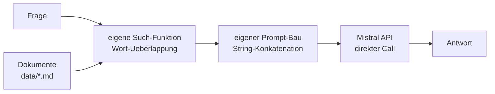

# Modul 2 – 🧱 BUILD 1: Der Assistent in reinem Python

> **Das Leitprinzip der Akademie:** Du baust denselben **Personal Knowledge Assistant** drei Mal – jedes Mal mit besseren Werkzeugen. Übersicht: [„Same Problem, Three Architectures"](../docs/same-problem-three-architectures.md)

**Build 1-Ziel:** Verstehen, was wirklich passiert – ohne jedes KI-Framework. Nur Python, der direkte Mistral-Call und deine eigenen Funktionen.



| # | Aufgabe | Zeit | API? |
|---|---|---|---|
| 2.1 | [`tasks/01-pure-python-assistent.md`](tasks/01-pure-python-assistent.md) – Dokumente + Suche + LLM | ~60–90 Min | ⚠️ nur mit Key |
| 2.2 | [`tasks/02-orchestrierung-und-oberflaeche.md`](tasks/02-orchestrierung-und-oberflaeche.md) – Manuelle Orchestrierung + Streamlit-Chat | ~45–60 Min | offline komplett |

**Ausführen:**
```bash
python3 02-build1-python-assistent/solutions/pure_python_assistant.py
streamlit run 02-build1-python-assistent/solutions/chat_ui.py
```

**Danach:** [`../03-build2-langchain-rag/`](../03-build2-langchain-rag/README.md) – **Build 2**: dasselbe Ziel, aber LangChain übernimmt das Fließband.
