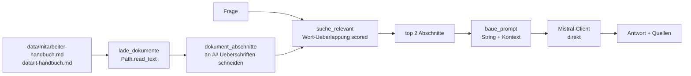

# Aufgabe 2.1 – Build 1a: Der Pure-Python-Wissens-Assistent 🧱

**Schwierigkeit:** Mittel · **Zeit:** ~60–90 Min · ⚠️ **Kosten:** nur mit Key (offline: kostenlos)

## Lernziel
Du baust die erste Version deines Personal Knowledge Assistant **komplett von Hand**: Dokumente laden, relevante Stellen finden, den Prompt selbst bauen, Mistral direkt aufrufen.

## Warum das wichtig ist
Frameworks verstellen den Blick. Wenn du *diese* Version verstanden hast, weißt du genau, was LangChain dir später abnimmt – und was es nur **versteckt**. **Metapher:** Bevor du ein Fertighaus kaufst, baust du einmal einen Schuppen aus Holz.

## Die Architektur (Build 1)

## Deine Mission
Baue `pure_python_assistant.py` **ohne LangChain-Imports**:
1. `lade_dokumente()`: liest alle `data/*.md`; zerlegt jeden Text an `## `-Überschriften in Abschnitte (Dict: `{"quelle": dateiname, "titel": ueberschrift, "text": ...}`).
2. `suche_relevant(frage, abschnitte, top=2)`: score = Anzahl gemeinsamer Wörter (kleingeschrieben, `split()`); liefere die besten Abschnitte.
3. `baue_prompt(frage, abschnitte)`: baue den Kontext **von Hand** als String (Quelle + Text je Abschnitt) plus die Anweisung: „Antworte NUR auf Basis des Kontexts; wenn nichts Passendes: sage das ehrlich."
4. `beantworte(frage)`: orchestriere alles, rufe Mistral direkt auf (`client.chat.complete`), gib Dict zurück: `{"antwort": ..., "quellen": [...]}`.
5. Fehlerbehandlung: keine Treffer → ehrliche Meldung; API-Fehler → deutsche Meldung.
6. Teste drei Fragen: „Wie viele Urlaubstage gibt es?", „Was gilt für Passwörter?", „Wie hoch ist das Weihnachtsgeld?" (→ ehrlich „nicht gefunden").

## Akzeptanzkriterien
- [ ] Kein einiger LangChain-Import in der Datei.
- [ ] Antworten nennen ihre Quellen (Datei + Abschnittstitel).
- [ ] Fragen ohne Treffer führen zur ehrlichen Nicht-gefunden-Antwort.
- [ ] Du kannst jede Zeile der eigenen Orchestrierung erklären.

## Hinweise
1. Zerlegen: `text.split("## ")` – erster Eintrag ist der Titel-Bereich, danach je `titel\n\n...inhalt`.
2. Wortvergleich: `set(frage.lower().split()) & set(abschnitt["text"].lower().split())`
3. Client: `lernakademie.llm_client.get_api_client()` (kapselt Anbieter + Offline-Simulation).
4. Die `data/`-Handbücher sind die gleichen wie im Capstone – du kennst die Antworten schon!

## Reflexionsfragen
1. Wie gut findet deine Wort-Überlappungssuche „freie Tage" statt „Urlaub"? Was fehlt (→ Embeddings, Build 2)?
2. Wie viele Stellen deines Codes müsstest du anfassen, um **drei** Dokumente statt zwei zu unterstützen – und welche sind davon „Boilerplate"?
3. Wo exactly entsteht die Antwort – in deinem Prompt-Bau oder im Modell?

## Referenzlösung + Walkthrough
→ [`solutions/pure_python_assistant.py`](../solutions/pure_python_assistant.py) – jede Funktion kommentiert.

## Weiter
2.2 – du spürst die **Schmerzen manueller Orchestrierung** und bekommst deine erste grafische Oberfläche.
