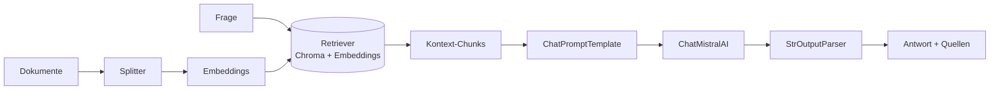

# Modul 3 – 🔗 BUILD 2: LangChain & Vektor-RAG

> **Build-It-3-Times:** gleiche Anwendung, bessere Werkzeuge. Übersicht: [„Same Problem, Three Architectures"](../docs/same-problem-three-architectures.md)

**Build 2-Ziel:** Du ersetzt deine handgebauten Teile aus Build 1 durch LangChain-Bausteine – und die naive Wortsuche durch **semantische Suche** (Embeddings + Vektor-DB). Am Ende steht dein Assistant mit **echter Antwortqualität** und Quellenangaben.



**Was Build 1 von Hand war → ist jetzt:**
| Build 1 (dein Code) | Build 2 (Baustein) |
|---|---|
| `baue_prompt` (String-Konkatenation) | `ChatPromptTemplate` |
| direkter Client-Call | `ChatMistralAI` (Runnable) |
| Antwort extrahieren | `StrOutputParser` |
| Wort-Überlappungssuche | Embeddings + Chroma + Retriever |

| # | Aufgabe | Zeit | API? |
|---|---|---|---|
| 3.1 | [`tasks/01-chains.md`](tasks/01-chains.md) – Fließbänder: Templates, Modelle, Parser | ~45 Min | ⚠️ nur mit Key |
| 3.2 | [`tasks/02-vektor-rag.md`](tasks/02-vektor-rag.md) – Chunking, Embeddings, Chroma, Retriever | ~60 Min | offline komplett |
| 3.3 | [`tasks/03-build2-assistent.md`](tasks/03-build2-assistent.md) – **Build 2 komplett**: RAG-Assistent mit Quellen & Struktur | ~60–90 Min | ⚠️ nur mit Key |

**Ausführen:**
```bash
python3 03-build2-langchain-rag/solutions/summarizer_chain.py
python3 03-build2-langchain-rag/solutions/vector_search.py
python3 03-build2-langchain-rag/solutions/document_qa.py
```

**Danach:** [`../04-knowledge-graphs/`](../04-knowledge-graphs/README.md) – warum semantische Suche allein nicht reicht: **Beziehungen**.
