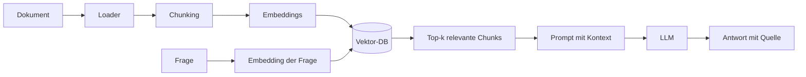

# Stufe 4 – RAG: Dem Modell Wissen geben 📚

**Ziel:** Du baust eine Anwendung, die Fragen zu **eigenen Dokumenten** beantwortet – mit Quellenangabe statt Halluzination. Das ist RAG: *Retrieval-Augmented Generation*.

## Warum RAG?

LLMs wissen viel – aber **nicht** dein Firmenhandbuch, deine Notizen, deine Rechnungen. Und selbst bei bekanntem Wissen können sie halluzinieren. RAG löst beide Probleme:

> **Metapher:** Eine Klausur ohne Spickzettel (nur Gedächtnis = nacktes LLM) gegen eine Klausur **mit aufgeschlagenem Buch** (RAG): Wir schlagen vor der Antwort die relevanten Stellen nach und legen sie mit auf den Tisch (in den Prompt). Das Modell formuliert die Antwort *auf Basis dieser Stellen*.

Der RAG-Kreislauf:



## Aufgaben

| # | Aufgabe | Schwierigkeit | API? |
|---|---|---|---|
| 4.1 | [`tasks/01-dokument-laden.md`](tasks/01-dokument-laden.md) | Anfänger | ⚠️ nur mit Key |
| 4.2 | [`tasks/02-chunking-und-embeddings.md`](tasks/02-chunking-und-embeddings.md) | Leicht | nein (offline möglich) |
| 4.3 | [`tasks/03-vektor-datenbank-und-suche.md`](tasks/03-vektor-datenbank-und-suche.md) | Leicht | ⚠️ nur mit Key (Embeddings) |
| 4.4 | [`tasks/04-dokumenten-qa.md`](tasks/04-dokumenten-qa.md) | Mittel | ⚠️ nur mit Key |

## Übungsdokumente

In [`data/`](data/) liegen zwei frei erfundene „Firmen-Handbücher" (Mitarbeiter- und IT-Handbuch). Alle Fragen und Suchen beziehen sich auf sie – so vergleichst du immer mit etwas, das du selbst nachlesen kannst.

## Ausführen

```bash
python3 04-rag-and-knowledge/solutions/document_loader.py
python3 04-rag-and-knowledge/solutions/chunker.py
python3 04-rag-and-knowledge/solutions/vector_search.py
python3 04-rag-and-knowledge/solutions/document_qa.py
```

## Infrastruktur (bewusst einsteigerfreundlich)

- **Chroma** als Vektor-Datenbank: läuft lokal, kostenlos, ohne Server (in `requirements.txt` enthalten).
- **Embeddings:** mit Key nutzt die Lösung echte Mistral-Embeddings (`mistral-embed`); ohne Key unser transparentes Schlüsselwort-Modell aus `lernakademie/offline_embeddings.py`. Im Offline-Fall formuliere Suchfragen mit Wörtern aus den Dokumenten (z. B. „Urlaub", „Passwort") – im echten Modul versteht die Suche auch Umschreibungen.

## Danach

Damit hast du das komplette Fundament für echte KI-Anwendungen! Der [Lernfahrplan](../docs/learning-roadmap.md) zeigt, wie es mit LangGraph, Agenten und Multi-Agent-Systemen (Stufen 5–9) weitergeht – diese bauen direkt auf deiner RAG-Chain auf.
