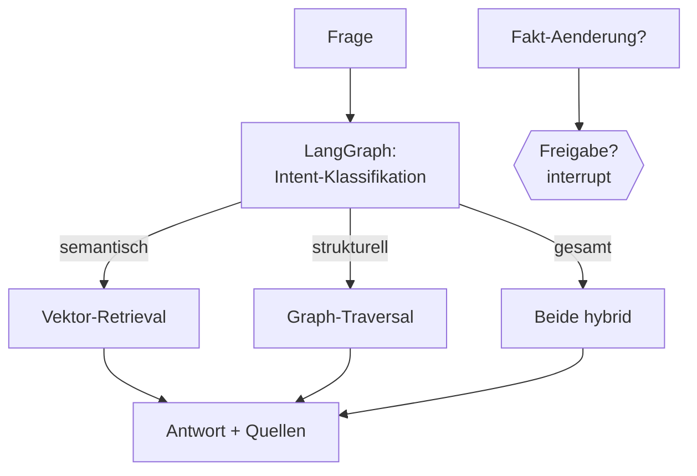

# Modul 5 – 🚀 BUILD 3: LangGraph + GraphRAG + Hybrid-Retrieval

> **Build-It-3-Times:** Finale Ausbaustufe deines Personal Knowledge Assistant. Übersicht: [„Same Problem, Three Architectures"](../docs/same-problem-three-architectures.md)

**Build 3-Ziel:** Zwei Wissenssysteme (Vektor-DB **und** Knowledge Graph) unter einer **LangGraph-Steuerung**: Der Agent entscheidet pro Frage, welche Quelle(n) sie braucht – und Graph-Änderungen passieren nur mit deiner Freigabe.



**Wichtig:** Der Knowledge Graph ist **externes, strukturiertes Wissen**; LangGraph **steuert den Workflow**. Beide bleiben getrennt – austauschbar, testbar.

| # | Aufgabe | Zeit | API? |
|---|---|---|---|
| 5.1 | [`tasks/01-langgraph-workflows.md`](tasks/01-langgraph-workflows.md) – State, Nodes, Routing, Loops | ~60–90 Min | keine |
| 5.2 | [`tasks/02-hybrid-retrieval.md`](tasks/02-hybrid-retrieval.md) – Vektor vs. Graph vs. Kombination | ~60 Min | offline komplett |
| 5.3 | [`tasks/03-graph-fuellen-und-abfragen.md`](tasks/03-graph-fuellen-und-abfragen.md) – LLM-Extraktion & NL→Cypher (Whitelist) | ~60–90 Min | ⚠️/offline |
| 5.4 | [`tasks/04-build3-assistent.md`](tasks/04-build3-assistent.md) – **Build 3 komplett**: Routing + Freigabe | ~90 Min | offline komplett |

**Ausführen:**
```bash
python3 05-build3-langgraph-graphrag/solutions/hello_graph.py
python3 05-build3-langgraph-graphrag/solutions/hybrid_retrieval.py
python3 05-build3-langgraph-graphrag/solutions/nl_to_cypher.py
python3 05-build3-langgraph-graphrag/solutions/graph_aware_agent.py
```

**Danach:** [`../06-agents-und-tools/`](../06-agents-und-tools/README.md) – Vertiefung: vollwertige Agenten mit Tools, Gedächtnis und Supervisor.
