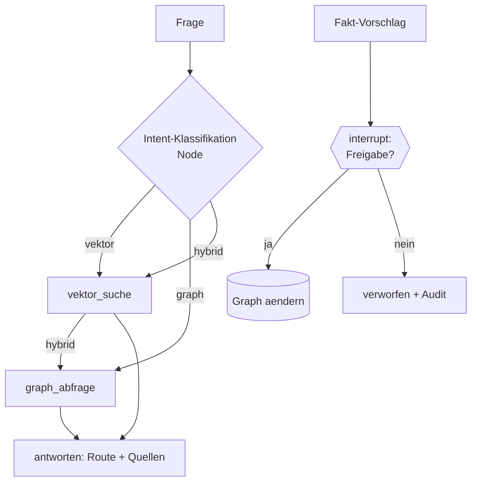

# Aufgabe 5.4 – Build 3 komplett: Graph-Routing-Assistent mit Freigabe 🎯

**Schwierigkeit:** Fortgeschritten · **Zeit:** ~90 Min · **Kosten:** keine (offline komplett)

## Lernziel
Du schließt Build 3 ab: ein LangGraph-Agent, der per Intent-Klassifikation zwischen **Vektor-, Graph- und Hybrid-Retrieval** wählt – plus **Human-in-the-Loop** für Graph-Schreibzugriffe.

## Warum das wichtig ist
Hybrid-Retrieval (5.2) ruft **immer beide** Quellen auf – teuer und langsam. Der Agent entscheidet gezielt: „Dokumentfrage → nur Vektor", „Verbindungsfrage → nur Graph", „Gesamtfrage → beide". Und: Ein hallucinierter Fakt im Graph vergiftet **jede** zukünftige Antwort – daher die Freigabe-Pflicht (Metapher: Gegenzeichnung auf der Krankenakte).

## Die Build-3-Architektur (dein Assistent!)

## Deine Mission
1. **Routing-Agent:** klassifiziere-Node (offline: Regel-Logik mit dokumentierten Schlüsselwörtern) → konditionale Kanten zu zwei Tool-Nodes (Vektor, Graph) → Antwort-Node; Hybrid-Fall ruft beide (sequenziell oder parallel – begründe deine Wahl im Kommentar).
2. **Vier Testfragen** (je eine pro Route + Hybrid) – Ausgabe zeigt Route + Ergebnisse.
3. **Freigabe-Workflow:** Fakten-Vorschläge → `interrupt()` **vor** der Änderung (Details im Interrupt-Payload!) → `Command(resume=True/False)` → genehmigt: Kante anlegen (mit Entity Resolution!); abgelehnt: verwerfen. **Audit-Log** über alle Entscheidungen.
4. **Beweise:** Kanten-Anzahl vor/nach Genehmigung; Graph unverändert nach Ablehnung.

## Akzeptanzkriterien
- [ ] Die dokumentlastige Frage ruft NICHT den Graph auf (und umgekehrt).
- [ ] Der Hybrid-Fall nutzt beide Quellen; der State trennt `dokumente` und `graph_fakten`.
- [ ] Genehmigung → sichtbare Graph-Änderung; Ablehnung → unverändert, kein Crash.
- [ ] Das Audit-Log listet beide Fälle; Interrupt-Daten enthalten den Grund.

## Hinweise
1. `interrupt()` braucht einen **Checkpointer** (`MemorySaver`) am `compile()`.
2. Resume mit **demselben** `thread_id`-Config – sonst findet LangGraph den angehaltenen Lauf nicht.
3. Alles Bausteine aus 5.1–5.3: Hier wird nur orchestriert – das ist Build 3!
4. Genau diese Architektur läuft (in größerer Form) im Finale: [`final-project/knowledge-research-agent/`](../../final-project/knowledge-research-agent/README.md)

## Reflexionsfragen
1. Was kostet die Fehlklassifikation – und wie würde ein „Fallback auf Hybrid" bei unsicheren Fällen wirken?
2. Warum reicht die lesende Whitelist (5.3) nicht mehr, sobald das System „aus Dokumenten lernen" soll?
3. Vergleiche mit Build 1/2: Was kann dein Assistent jetzt, das beide gemeinsam nicht konnten? (→ [„Same Problem, Three Architectures"](../../docs/same-problem-three-architectures.md))

## Referenzlösung + Walkthrough
→ [`solutions/graph_aware_agent.py`](../solutions/graph_aware_agent.py), [`solutions/approval_graph_ops.py`](../solutions/approval_graph_ops.py)

## Weiter
[`../06-agents-und-tools/`](../../06-agents-und-tools/README.md) – Agenten-Vertiefung: Tools, Gedächtnis, Supervisor.
