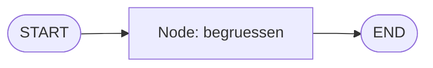

# Aufgabe 5.1 – Hello Graph: dein erster Graph 🕸️

## Schwierigkeit
Anfänger · **Kosten: keine** (reine Python-Logik)

## Lernziel
Du baust, kompilierst und startest deinen ersten LangGraph-Graphen mit einem Node, Entry-Point und Finish-Point.

## Warum ist das wichtig?
Graphen sind das Fundament für alle Agenten- und Multi-Agent-Systeme der nächsten Stufen. Der erste Graph ist absichtlich winzig – es geht nur um die **Mechanik**: Schema → Node → Kante → kompilieren → starten.

## Das Konzept einfach erklärt

Ein Graph ist ein Rezeptplan: „Fange an (START), gehe zu Station *begruessen*, dann fertig (END)." Jede Station bekommt den **State** (Notizblock), arbeitet, und gibt Änderungen zurück.

## Die technische Erklärung
1. **State-Schema:** ein `TypedDict` – die Felder des gemeinsamen Notizblocks. Jede Node-Funktion nimmt den State entgegen und gibt ein **Dictionary mit Änderungen** zurück (LangGraph mischt diese Updates in den State ein).
2. **Node registrieren:** `graph.add_node("name", funktion)`.
3. **Kanten:** `graph.add_edge(START, "name")` und `graph.add_edge("name", END)`.
4. **Kompilieren:** `app = graph.compile()` – daraus entsteht ein ausführbares Runnable mit `.invoke(...)`.
5. Der Einstiegswert ist ein Dictionary, das dem Schema entspricht.

## Voraussetzungen
- Stufe 1 (Funktionen, Dictionaries)

## Deine Mission
Schreibe `hello_graph.py`:
1. State-Schema `Zustand` mit dem Feld `begruessung: str`.
2. Node-Funktion `begruessen`, die `{"begruessung": "Hallo LangGraph!"}` zurückgibt.
3. Graph bauen: START → `begruessen` → END, kompilieren.
4. Starte mit `app.invoke({"begruessung": ""})` und gib das Ergebnis aus.
5. **Bonus:** Füge einen zweiten Node `verabschieden` hinzu, der das Feld um „ … und tschüss!" erweitert. Beobachte: Nodes geben nur **Änderungen** zurück – der Rest des States bleibt erhalten.

## Akzeptanzkriterien
- [ ] Der Graph läuft ohne Fehler und liefert das gefüllte State-Feld.
- [ ] Du kannst START, END, Node, Edge in eigenen Worten erklären.
- [ ] Bonus: Zwei Nodes sind verkettet und beide Ergebnisse sichtbar.

## Hinweise
1. Importe: `from langgraph.graph import StateGraph, START, END` und `from typing import TypedDict`.
2. Node-Funktionen sind ganz normale Python-Funktionen mit **einem** Parameter (State) und Dict-Rückgabe.
3. Kompilieren nicht vergessen – `StateGraph(...)` allein ist noch nicht lauffähig.

## Reflexionsfragen
1. Warum geben Nodes nur *Änderungen* zurück statt des kompletten States? (Tipp: Was passiert bei 10 Nodes, die alle denselben Notizblock erweitern sollen?)
2. Was ist der Unterschied zwischen `graph.add_node(...)` und dem Moment des `compile()`?
3. Wo ist in diesem Design Platz für ein LLM (Antwort: in **jeder** Node-Funktion – siehe Stufe 6)?

## Häufige Fehler
| Fehler | Lösung |
|---|---|
| `ValueError: ... must end with END` o.ä. | fehlende Kante zu END |
| KeyError auf State-Feld | Einstiegs-Dict an Schema angleichen |
| Node-Funktion gibt String statt Dict zurück | immer `{"feld": wert}` zurückgeben |

## Referenzlösung
→ [`solutions/hello_graph.py`](../solutions/hello_graph.py)

## Code-Walkthrough
In der Lösungsdatei, Zeile für Zeile.

## Was haben wir gelernt?
State-Schema, Nodes, Edges, START/END, kompilieren, invoke.

## Was kommt als Nächstes?
Ein Node war nur der Aufwärmer. Aufgabe 5.2: Drei Stationen teilen sich **einen** State – du siehst, wie der Notizblock durchs Bahnhofnetz wandert.
