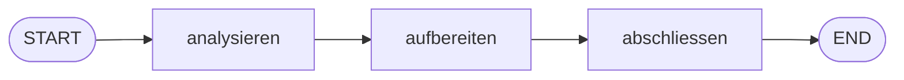

# Aufgabe 5.2 – State & Nodes: der gemeinsame Notizblock 📓

## Schwierigkeit
Anfänger · **Kosten: keine**

## Lernziel
Du baust einen Drei-Schritte-Workflow, in dem alle Nodes denselben **State** lesen und erweitern – das zentrale Konzept von LangGraph.

## Warum ist das wichtig?
In Ketten (Stufe 3) fließt **ein Wert** durchs Fließband. In Graphen brauchen viele Stationen Zugriff auf **verschiedene** Informationen gleichzeitig (z. B. der Titel *und* der Ton *und* das Fertig-Flag). Der State ist die Lösung – und die Basis für alles, was folgt.

## Das Konzept einfach erklärt



**Metapher – das Baustellen-Notizbuch:** Auf einer Baustelle hängt ein gemeinsames Notizbuch aus: Der Vermesser trägt die Fläche ein, der Architekt liest sie und trägt die Zimmerzahl ein, die Bauleitung liest beides und vermerkt „freigegeben". Niemand muss dem anderen etwas zurufen – **das Notizbuch ist die Wahrheit**.

## Die technische Erklärung
- Der State ist ein `TypedDict` mit beliebig vielen Feldern.
- Jede Node-Funktion bekommt den **kompletten aktuellen** State als Parameter (`state["feld"]` lesbar) und gibt nur ihre **Änderungen** zurück.
- LangGraph führt Änderungen per **Merge** zusammen (Standard: überschreiben pro Feld).
- Das Ergebnis von `app.invoke(...)` ist der finale State – alle Felder sichtbar.

## Voraussetzungen
- Aufgabe 5.1

## Deine Mission
Baue `state_chain.py` – eine kleine „Text-Werkstatt" mit Schema:
```python
class WerkstattZustand(TypedDict):
    rohtext: str
    woerter: int
    titel: str
    fertig: bool
```
1. Node `analysieren`: zählt die Wörter des Rohtexts → Feld `woerter`.
2. Node `aufbereiten`: baut aus den ersten 3 Wörtern des Rohtexts einen Titel in GROSSBUCHSTABEN → Feld `titel` (liest dafür `rohtext` aus dem State!).
3. Node `abschliessen`: setzt `fertig=True` und nutzt `woerter` UND `titel`, um einen Abschluss-Satz in der Ausgabe zu erzeugen (print oder Feld deiner Wahl).
4. Kette: START → analysieren → aufbereiten → abschliessen → END.
5. Starte mit einem Beispieltext und gib den kompletten finalen State aus.

## Akzeptanzkriterien
- [ ] Node 2 liest ein Feld, das Node 1 geschrieben hat.
- [ ] Node 3 liest Felder von Node 1 **und** 2.
- [ ] Der finale State enthält alle vier Felder korrekt.
- [ ] Jede Node-Funktion gibt nur ihre Änderungen zurück (nicht den ganzen State kopieren!).

## Hinweise
1. Wortzahl: `len(state["rohtext"].split())`
2. Titel: `" ".join(state["rohtext"].split()[:3]).upper()`
3. Bekanntes Muster: Node-Funktionen = reine Funktionen (Stufe-1-Stil) → leicht testbar!

## Reflexionsfragen
1. Was wäre passiert, wenn Node „aufbereiten" den Rohtext *überschreiben* würde? Wie hättest du das bemerkt?
2. Warum ist „Nodes geben nur Diffs zurück" robuster als „jede Node gibt den kompletten State zurück"?
3. Vergleiche mit Stufe 3: Welche Information könnte in einer Chain **nicht** zwischen zwei Runnables mitgereist werden, im State aber problemlos?

## Häufige Fehler
| Fehler | Lösung |
|---|---|
| `KeyError: 'rohtext'` in Node | Einstiegs-Dict enthält nicht alle Startfelder |
| Node-Updates verschwinden | Rückgabe-Dict mit korrektem Feldnamen |
| Testbarkeitsprobleme | Nodes klein und rein halten – Logik in eigene Funktionen |

## Referenzlösung
→ [`solutions/state_chain.py`](../solutions/state_chain.py)

## Code-Walkthrough
In der Lösungsdatei; beachte, dass `analysieren` nur `woerter` zurückgibt, obwohl es mehr gelesen hat.

## Was haben wir gelernt?
Geteilter State, Merge-Verhalten, Informationsfluss über mehrere Nodes.

## Was kommt als Nächstes?
Bislang fährt dein Zug geradeaus. Aufgabe 5.3 baut die **Weiche**: ein konditionaler Edge, der anhand des States entscheidet, welche Station als Nächste dran ist.
