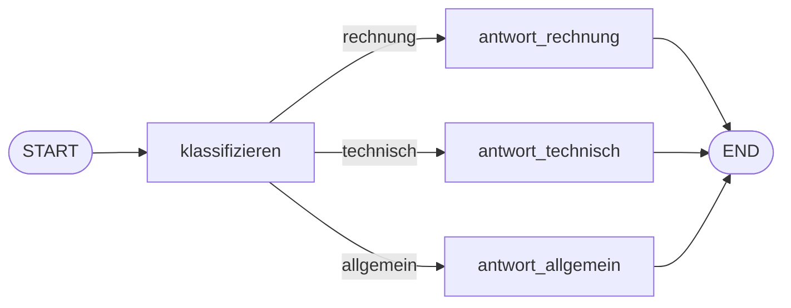

# Aufgabe 5.3 – Konditionales Routing: die Weiche 🚂

## Schwierigkeit
Leicht · **Kosten: keine**

## Lernziel
Du baust eine Verzweigung: Je nach Inhalt des States wählt der Graph zur Laufzeit einen anderen Weg – mit `add_conditional_edges`.

## Warum ist das wichtig?
Das ist der Moment, in dem dein Workflow „intelligent" wirkt: Support-Tickets gehen zu unterschiedlichen Fachstellen, E-Mails werden nach Dringlichkeit sortiert, Anfragen landen beim richtigen Agenten. **Konditionale Edges sind das Gehirn jedes Agenten- und Multi-Agent-Systems** (Stufe 6/7: genau so wählt ein Supervisor seine Mitarbeiter-Agenten!).

## Das Konzept einfach erklärt

**Metapher – der Fahrdienstleiter:** Er liest den Notizblock (State) und stellt die Weiche: Güterzug → Güterschuppen, Personenzug → Bahnsteig 3, Sonderzug → Depot. Er erledigt selbst **keine** Arbeit – er entscheidet nur, wohin die Reise geht.

## Die technische Erklärung
- `graph.add_conditional_edges("klassifizieren", weichen_funktion, {"rechnung": "antwort_rechnung", ...})`
  - `weichen_funktion(state)` liefert einen **Schlüssel** (z. B. `"rechnung"`),
  - das Mapping-Dict übersetzt den Schlüssel in den **Namen des nächsten Nodes**.
- Alternative (einfacher): die Weichen-Funktion liefert direkt den Node-Namen – das Mapping-Dict entfällt.
- Die Weichen-Funktion **schreibt nichts** in den State; sie liest nur. (Soll sie auch schreiben, nutzt man zwei Nodes hintereinander: erst klassifizieren, dann weichen.)

## Voraussetzungen
- Aufgabe 5.2

## Deine Mission
Baue `routing_graph.py` – einen **Support-Ticket-Router**:
1. Schema: `{"eingabe": str, "kategorie": str, "antwort": str}`.
2. Node `klassifizieren`: Regel-Logik (Stufe-2-Wissen!): enthält der Text „rechnung"/„betrag" → `"rechnung"`; „funktioniert"/„fehler"/„absturz" → `"technisch"`; sonst `"allgemein"`. Schreibt `kategorie`.
3. **Drei** Antwort-Nodes mit passenden, unterschiedlichen Textbausteinen (alle schreiben `antwort`).
4. Konditionaler Edge von `klassifizieren` zum richtigen Antwort-Node (jeder Antwort-Node → END).
5. Teste mit **drei** Eingaben (eine pro Kategorie) und gib jeweils Kategorie + Antwort aus.

## Akzeptanzkriterien
- [ ] Alle drei Kategorien landen bei ihrem eigenen Antwort-Node.
- [ ] Die Weichen-Entscheidung liest `kategorie` aus dem State.
- [ ] Die Klassifizierung ist als eigene Node gekapselt (nicht in die Weiche gestopft).
- [ ] Der finale State zeigt Eingabe, Kategorie und Antwort.

## Hinweise
1. Weiche: `def weiche(state): return state["kategorie"]` + Mapping-Dict in `add_conditional_edges`.
2. Kleinbuchstaben prüfen: `text = state["eingabe"].lower()`.
3. Reihenfolge der Regeln zählt (erst „rechnung", dann „technisch", sonst allgemein).

## Reflexionsfragen
1. Warum ist die Weichen-Funktion eine *Lesende* und der Klassifizierer eine *Schreibende* Station? Was würde passieren, wenn du beides in einer Funktion kombinierst?
2. Wo liegt hier die Grenze zwischen „Regel-Logik" (klassifizieren) und „Graph-Logik" (Weiche)? Und was würdest du in Stufe 6 als Klassifizierer einsetzen, wenn Regeln nicht reichen? (→ LLM-Node!)
3. Wie erweiterst du das System um eine vierte Kategorie – an wie vielen Stellen musst du anfassen?

## Häufige Fehler
| Fehler | Lösung |
|---|---|
| Weiche liefert Text, Mapping fehlt | Mapping-Dict {schluessel: node_name} mitgeben oder Node-Namen liefern |
| `KeyError` in der Weiche | Klassifizierer hat `kategorie` noch nicht geschrieben → Reihenfolge der Nodes prüfen |
| Alle Tickets landen bei „allgemein" | Regeln prüfen: Kleinbuchstaben, Substring-Schreibweise |

## Referenzlösung
→ [`solutions/routing_graph.py`](../solutions/routing_graph.py)

## Code-Walkthrough
In der Lösungsdatei; besonders die Trennung klassifizieren → weiche.

## Was haben wir gelernt?
Konditionale Edges, Weichen-Funktionen, Laufzeit-Entscheidungen im Graphen.

## Was kommt als Nächstes?
Verzweigungen war die eine Hälfte der Macht. Aufgabe 5.4 bringt die zweite: **Schleifen** – der Zug fährt zurück, bis die Arbeit gut genug ist.
