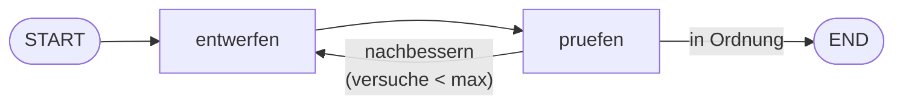

# Aufgabe 5.4 – Schleifen: zurück bis es gut ist 🔁

## Schwierigkeit
Mittel · **Kosten: keine**

## Lernziel
Du baust einen **Loop** in den Graphen: entwerfen → prüfen → (nicht gut? zurück zum Entwerfen!) – mit Sicherheitsbremse gegen Endlosschleifen.

## Warum ist das wichtig?
Schleifen sind das Kernmuster „denkender" Systeme: Agenten planen, handeln, bewerten, korrigieren. Ohne **Loop-Limit** kann ein autonomer Workflow endlos laufen (Kosten! Zeit!). Du lernst beides: die Macht und die Bremse.

## Das Konzept einfach erklärt

**Metapher – der Qualitätskreis in der Küche:** Der Koch richtet den Teller an (entwerfen), die Qualitätskontrolle prüft (pruefen). Nicht schön? Zurück an den Herd! Aber: Nach drei Versuchen wird serviert, egal was kommt – sonst wartet der Gast ewig. Die **Versuchszähler** im Notizblock ist die Bremse.

## Die technische Erklärung
- Schleife = konditionaler Edge, der auf einen **früheren** Node zurückzeigt (hier: `pruefen → entwerfen`).
- Damit der Loop endet, braucht der State einen **Zähler** (`versuche`) und ein **Limit** (`max_versuche`) – die Weichen-Funktion prüft beides.
- Das Update `{"versuche": state["versuche"] + 1}` zeigt eine Stärke des Merge-Verhaltens: Nodes können Felder **fortschreiben**.
- Typische Loop-Gefahr: Ändert der Loop-Node **nichts**, prüft die Weiche aber genau auf diese Änderung → Endlosschleife. Deshalb: Jede Runde muss messbar etwas verändern!

## Voraussetzungen
- Aufgabe 5.3 (Weichen)

## Deine Mission
Baue `loop_graph.py` – eine simulierte „Textpolier-Werkstatt":
1. Schema: `{"text": str, "bewertung": int, "versuche": int, "max_versuche": int, "historie": list}`.
2. Node `entwerfen`: verbessert den Text – **simuliert**: hängt pro Versuch einen Satz an (z. B. „ (Politur {versuche})"). Schreibt auch `versuche + 1` und hängt den neuen Text an `historie` an.
3. Node `pruefen`: bewertet mit einfacher Metrik – z. B. `bewertung = min(100, 30 * versuche + laenge_faktor)`. „Genug" ab `bewertung >= 60`.
4. Weiche: `bewertung >= 60` oder `versuche >= max_versuche` → END; sonst zurück zu `entwerfen`.
5. Starte mit maximalem Aufwand: Wähle Text und Limit so, dass **mindestens ein** Nachbessern passiert, aber der Lauf **garantiert endet**. Gib die Historie aus – jeder Polierdurchgang sichtbar!

## Akzeptanzkriterien
- [ ] Der Graph endet immer (auch mit „schlechtem" Startwert).
- [ ] Die `historie` zeigt jeden Durchlauf.
- [ ] `versuche` wird in jeder Runde inkrementiert (im State!).
- [ ] Du kannst erklären, warum die Weiche ohne Limit gefährlich wäre.

## Hinweise
1. Listen im State: Standard-Merge **überschreibt** Felder. Zum Anhängen gib die neue Liste zurück: `{"historie": state["historie"] + [neuer_text]}`.
2. Bewertungs-Metrik bewusst simpel halten – es geht um den Loop, nicht um Textqualität.
3. Konsolen-Ausgabe pro Runde hilft, den Ablauf zu „sehen" (in der Lösung: kleine print-Zeilen in den Nodes).

## Reflexionsfragen
1. Warum braucht jede Schleife **zwei** Endbedingungen (Qualität UND Limit)?
2. Wo in einem echten LLM-Workflow (Stufe 6/8) würden „entwerfen" und „pruefen" jeweils durch was ersetzt? (→ LLM-Node + LLM-Kritiker-Node)
3. Was kostet eine Schleife mit LLM-Nodes, die pro Durchlauf läuft – und wie begrenzt man das Budget in der Praxis?

## Häufige Fehler
| Fehler | Lösung |
|---|---|
| Endlosschleife | Zähler nicht inkrementiert oder Weiche prüft ihn nicht |
| `historie` wächst nicht | Überschreiben statt neue Liste zurückgeben |
| Weiche-Regeln widersprüchlich | erst Limit prüfen, dann Qualität (oder umgekehrt – aber konsistent!) |

## Referenzlösung
→ [`solutions/loop_graph.py`](../solutions/loop_graph.py)

## Code-Walkthrough
In der Lösungsdatei; besonders Zähler-Update und Doppel-Bedingung in der Weiche.

## Was haben wir gelernt?
Loops, Zähler im State, Loop-Limits, Historien als Debugging-Werkzeug.

## Was kommt als Nächstes?
🎉 Du beherrschst jetzt die komplette Graphen-Mechanik: State, Nodes, Edges, Weichen, Schleifen. **Stufe 6** verbindet sie mit LLMs: Agenten, die **Tools** benutzen, sich erinnern (Checkpointer) und vor sensiblen Aktionen beim Menschen nachfragen (Interrupt).
