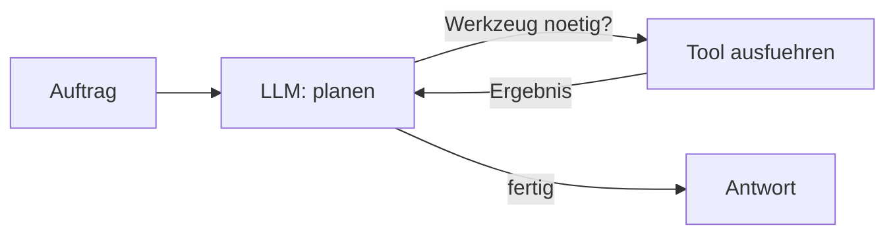

# Stufe 6 – KI-Agenten 🤖

**Ziel:** Du verstehst den Unterschied zwischen einer **Anwendung** und einem **Agenten** – und baust Agenten mit Tools, Erinnerung (Checkpointer) und menschlicher Freigabe (Human-in-the-Loop).

## Was ist ein Agent?

Eine **Chain/Anwendung** führt einen festgelegten Ablauf aus: du (der Entwickler) entscheidest jeden Schritt vorab. Ein **Agent** dagegen bekommt **Werkzeuge** (Tools) und entscheidet **selbst**, welches Werkzeug er wann benutzt, um das Ziel zu erreichen – in einer Schleife (planen → handeln → beobachten → ggf. weitermachen).

**Metapher:** Eine Chain ist ein Fließbandrezept. Ein Agent ist ein **Handwerker mit Werkzeugkasten**: Er schaut sich den Auftrag an, greift zum passenden Werkzeug, prüft das Ergebnis und greift bei Bedarf zum nächsten – bis der Auftrag erledigt ist.



## Wann Agent – wann deterministischer Workflow?

| Situation | Empfehlung |
|---|---|
| Ablauf immer gleich, Schritte bekannt | **Graph/Chain** (Stufe 3/5) – billiger, prüfbar, verlässlich |
| Welches Werkzeug nötig ist, hängt vom Einzelfall ab | **Agent** |
| Hohe Kosten/Fehler folgen | Agent **mit** Freigabe-Schritt (Human-in-the-Loop) oder lieber deterministisch |

Faustregel: **So deterministisch wie möglich, so agentic wie nötig.**

## Aufgaben

| # | Aufgabe | Schwierigkeit | API? |
|---|---|---|---|
| 6.1 | [`tasks/01-erstes-tool.md`](tasks/01-erstes-tool.md) | Leicht | ⚠️ nur mit Key |
| 6.2 | [`tasks/02-werkzeugkasten.md`](tasks/02-werkzeugkasten.md) | Leicht | ⚠️ nur mit Key |
| 6.3 | [`tasks/03-wissens-agent.md`](tasks/03-wissens-agent.md) | Mittel | ⚠️ nur mit Key |
| 6.4 | [`tasks/04-gedaechtnis-und-freigabe.md`](tasks/04-gedaechtnis-und-freigabe.md) | Mittel | ⚠️ nur mit Key |

## Ausführen

```bash
python3 06-ai-agents/solutions/first_tool_agent.py
python3 06-ai-agents/solutions/toolbox_agent.py
python3 06-ai-agents/solutions/knowledge_agent.py
python3 06-ai-agents/solutions/memory_approval_agent.py
```

**Offline-Modus:** Die Akademie-Simulation erkennt Tool-Namen in deiner Eingabe und simuliert das Tool-Calling – so kannst du die komplette Agenten-Mechanik ohne Key üben. Mit Key entscheidet das echte Mistral-Modell.

## Aktuelle API-Referenz

- [Agenten mit `create_agent` (langchain.agents)](https://python.langchain.com/docs/how_to/build_agent/) – die aktuelle, empfohlene API (nicht die ältere `create_react_agent`-Variante aus langgraph.prebuilt)
- [Human-in-the-Loop / interrupt](https://docs.langchain.com/oss/python/langgraph/add-human-in-the-loop)

## Danach
Weiter mit [`../07-advanced-langgraph/README.md`](../07-advanced-langgraph/README.md): mehrere Agenten, Supervisor, Parallelität.
