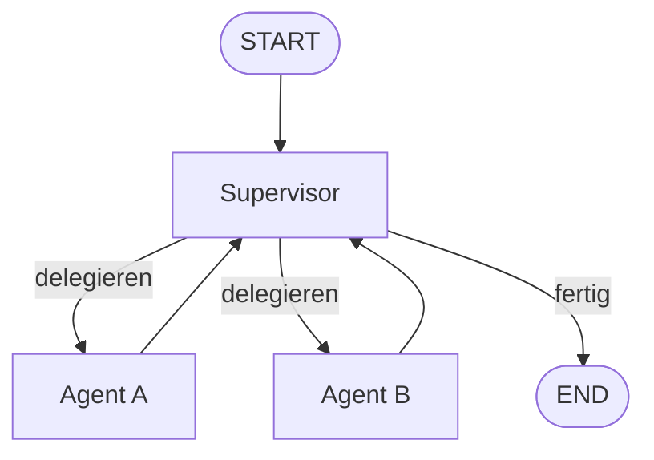

# Stufe 7 – Fortgeschrittenes LangGraph 🏢

**Ziel:** Vom einzelnen Agenten zum **Team**: parallele Ausführung, Subgraphs als abgeschlossene Abteilungen und ein **Supervisor**, der koordiniert.

## Was du hier lernst

Bislang war jeder Graph eine gerade oder verzweigte Kette von Stationen. Echte Systeme sind Organisationen:



- **Parallelität** (7.1): mehrere Stationen arbeiten **gleichzeitig** und ihre Ergebnisse fließen zusammen (Map-Reduce).
- **Subgraphs** (7.2): ein kompletter Graph als **eine Station** in einem größeren Graphen – wie eine Abteilung mit eigener interner Organisation.
- **Supervisor-Muster** (7.3): ein zentraler Koordinator entscheidet, wer als Nächstes arbeitet – das Standardmuster Multi-Agenten-Systeme (und die Vorstufe zu Stufe 8, Projekt C).

## Aufgaben

| # | Aufgabe | Schwierigkeit | API? |
|---|---|---|---|
| 7.1 | [`tasks/01-parallelaufgaben.md`](tasks/01-parallelaufgaben.md) | Mittel | nein |
| 7.2 | [`tasks/02-subgraphs.md`](tasks/02-subgraphs.md) | Mittel | nein |
| 7.3 | [`tasks/03-supervisor.md`](tasks/03-supervisor.md) | Fortgeschritten | ⚠️ nur mit Key |

## Ausführen

```bash
python3 07-advanced-langgraph/solutions/parallel_workflow.py
python3 07-advanced-langgraph/solutions/subgraph_workflow.py
python3 07-advanced-langgraph/solutions/supervisor_workflow.py
```

Aufgaben 7.1 und 7.2 laufen mit reiner Python-Logik (**komplett offline, ohne Key**). Der Supervisor in 7.3 nutzt ein LLM für die Delegations-Entscheidung – offline simuliert, mit Key echt.

## Danach
Weiter mit [`../08-real-world-projects/README.md`](../08-real-world-projects/README.md): vier komplette Anwendungen, die alles vereinen.
