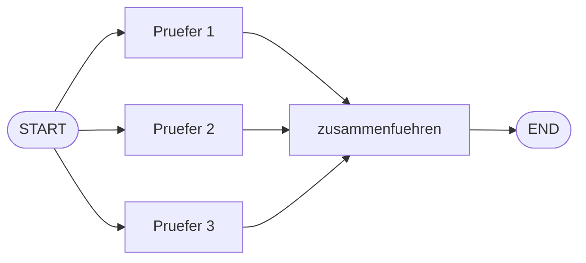

# Aufgabe 7.1 – Parallelaufgaben & Zusammenführen 🖇️

## Schwierigkeit
Mittel · **Kosten: keine** (reine Python-Logik)

## Lernziel
Du lässt mehrere Nodes **gleichzeitig** arbeiten und führst ihre Ergebnisse in einem Sammel-Node zusammen (Map-Reduce-Muster).

## Warum ist das wichtig?
Recherche über drei Quellen, Prüfung aus drei Blickwinkeln, Übersetzung in drei Sprachen: Warum nacheinander, wenn es gleichzeitig geht? Parallelität ist der größte Latenz-Hebel in LLM-Workflows (und die Grundlage für Multi-Agent-Systeme).

## Das Konzept einfach erklärt

**Metapher – die Kommission:** Drei Prüfer erhalten **dieselbe** Akte, jeder liest sie unabhängig, dann sitzen sie zusammen und fassen ihre Urteile in einem Bericht zusammen. Wichtig: Der Sammel-Node wartet, bis **alle** Daumen hoch sind – LangGraph regelt die Synchronisation für dich.

## Die technische Erklärung
- Mehrere `add_edge(START, node)`-Aufrufe (oder mehrere Kanten von einem Node) erzeugen **parallele Zweige** – LangGraph führt beide Branchen aus.
- Der Merge-Node läuft erst, wenn **alle** eingehenden Zweige geliefert haben (Barriere).
- **Achtung, Schreibkonflikt:** Würden alle parallelen Nodes **dasselbe** Feld schreiben, gewinnt zufällig einer (Last-Write-Wins). Lösung: Jeder Zweig schreibt sein **eigenes** Feld (`befund_1`, `befund_2`, ...), und der Merge-Node kombiniert sie.
- Fortgeschritten (hier nur erwähnt): `Annotated[list, operator.add]` als Reducer erlaubt nebenläufiges **Anhängen** an dieselbe Liste.

## Voraussetzungen
- Stufe 5 (State, Nodes, Edges)

## Deine Mission
Baue `parallel_workflow.py` – eine „Text-Kommission" mit drei parallelen Prüfern:
1. State: `text`, `befund_1` (Wortzahl), `befund_2` (Zeichenzahl), `befund_3` (durchschnittliche Wortlänge), `bericht` (str).
2. Drei Prüfer-Nodes, die **jeweils eine Metrik** aus `text` berechnen und in **ihr eigenes** Feld schreiben.
3. Alle drei parallel von START, alle drei in den Node `zusammenfuehren`.
4. `zusammenfuehren` kombiniert die drei Befunde zu einem Bericht (String).
5. Teste mit zwei Texten; gib den finalen Bericht aus.

## Akzeptanzkriterien
- [ ] Die drei Prüfer laufen parallel (drei Kanten von START).
- [ ] Kein Schreibkonflikt: jeder Prüfer hat sein eigenes Feld.
- [ ] Der Bericht enthält alle drei Metriken.
- [ ] Du kannst erklären, warum ein gemeinsames Feld `befund` gefährlich wäre.

## Hinweise
1. Zwei Kanten von START: `graph.add_edge(START, "pruefer_1")` usw. – einfach dreimal.
2. Merge: `graph.add_edge("pruefer_1", "zusammenfuehren")` für alle drei.
3. Wortlänge: `sum(len(w) for w in woerter) / len(woerter)`.

## Reflexionsfragen
1. Woher „weiß" der Merge-Node, dass er warten muss? (Stichwort: Barriere)
2. Was wäre der Gewinn in einem echten LLM-Workflow – Rechenzeit, Kosten oder Latenz? (Nur eins davon!)
3. Wie müsstest du das Design ändern, wenn die drei Prüfer **je eine Liste von Befunden** sammeln sollen? (Reducer!)

## Häufige Fehler
| Fehler | Lösung |
|---|---|
| Merge läuft zu früh / Werte fehlen | alle Pfeile in den Merge-Node gezeichnet? |
| Ein Befund überschreibt den anderen | eigene Felder pro Zweig |
| `StateGraph` meckert über fehlende Felder | Einstiegs-Dict vollständig initialisieren |

## Referenzlösung
→ [`solutions/parallel_workflow.py`](../solutions/parallel_workflow.py)

## Code-Walkthrough
In der Lösungsdatei; besonders die drei eigenen Befund-Felder.

## Was haben wir gelernt?
Parallele Zweige, Merge-Barriere, Schreibkonflikte vermeiden.

## Was kommt als Nächstes?
Ganze Graphen als **eine Station**: Aufgabe 7.2 kapselt deinen Stufe-5-Qualitätsloop als Subgraph – Abteilungen im großen Firmengebäude.
