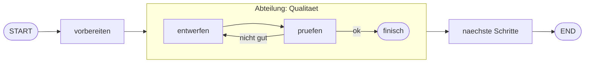

# Aufgabe 7.2 – Subgraphs: die Abteilung im Gebäude 🏢

## Schwierigkeit
Mittel · **Kosten: keine**

## Lernziel
Du baust einen **kompletten Graphen als Node** in einen größeren Graphen ein – wiederverwendbar, gekapselt, testbar.

## Warum ist das wichtig?
Multi-Agent-Systeme (Stufe 8!) werden sonst unwartbar: 40 Nodes in einem Graphen versteht niemand. Subgraphs erlauben **Hierarchie**: Der Chef-Graph kennt nur die Abteilung als Black Box; wie die Abteilung intern arbeitet, ist ihre Sache.

## Das Konzept einfach erklärt

**Metapher:** Der Geschäftsführer (Chef-Graph) sagt zur Abteilung Qualität: „Hier ist der Entwurf – gib mir ein abgesegnetes Produkt zurück." Er weiß nicht (und will nicht wissen), dass intern entworfen, geprüft, nachgebessert wird. **Die Abteilung hat einen eigenen Notizblock (State) und eine Tür nach außen (Schnittstelle).**

## Die technische Erklärung
- Ein **kompilierter** Graph ist selbst ein Runnable → du kannst ihn mit `add_node("qualitaet", subgraph_app)` wie jede Funktion einhängen.
- **State-Kopplung:** Der äußere und innere State sind standardmäßig **getrennt**. Der Subgraph erhält den State-Wert des äußeren Graphen als Input, wenn die Schemata zusammenpassen; die saubere Variante ist eine dünne **Adapter-Funktion**, die übersetzt (äußeres Dict → Subgraph-Input) und das Ergebnis zurückübersetzt.
- So bleibt der Subgraph **unabhängig testbar** – ein echter Wartbarkeits-Gewinn.

## Voraussetzungen
- Stufe 5 (insbesondere Loop aus 5.4 – wir recyceln das Muster!)

## Deine Mission
Baue `subgraph_workflow.py`:
1. **Subgraph `qualitaets_loop`:** dein Stufe-5.4-Muster (entwerfen → pruefen → Loop mit Limit), eigener State, eigenes compile() – wiederverwendbare „Abteilung".
2. **Äußerer Graph:** State mit Feldern `auftrag: str`, `freigegebenes_produkt: str`, `status: str`.
3. Nodes: `vorbereiten` (nimmt den Auftrag auf), dann die **Abteilung** (Adapter-Funktion ruft den Subgraph auf), dann `abschliessen` (setzt `status="versandbereit"`).
4. Der Adapter übersetzt: äußerer `auftrag` → Subgraph-Input; Subgraph-Ergebnis → `freigegebenes_produkt`.
5. Starte mit einem Testauftrag und gib alle Felder des äußeren States aus.

## Akzeptanzkriterien
- [ ] Subgraph läuft **auch standalone** (eigener invoke-Test in `main()`).
- [ ] Der äußere Graph nutzt die Abteilung über eine Adapter-Funktion.
- [ ] Das Produkt des Subgraphs landet im Feld `freigegebenes_produkt`.
- [ ] Der äußere State enthält **keine** internen Subgraph-Felder (Kapselung!).

## Hinweise
1. Subgraph als eigenständige Funktion `baue_qualitaets_loop()` bauen – dann kann der Adapter ihn erzeugen.
2. Adapter-Node: `def qualitaet(state): ergebnis = loop_app.invoke({...}); return {"freigegebenes_produkt": ergebnis["text"]}`
3. Das Kapselungs-Ziel siehst du am finalen State: `bewertung`/`versuche` des Loops tauchen dort **nicht** auf.

## Reflexionsfragen
1. Warum ist „Subgraph standalone testbar" ein Qualitätsmerkmal für Produktionssysteme?
2. Was wäre passiert, hättest du den Loop direkt in den großen Graphen kopiert? (Zähle die Knoten und möglichen Namenskonflikte!)
3. Wann lohnt sich ein Subgraph, wann ist er Overkill? (Faustregel: wiederverwendet ≥ 2× oder > ~8 Nodes intern?)

## Häufige Fehler
| Fehler | Lösung |
|---|---|
| Namenskonflikte Node/State | Subgraph-State getrennt halten, Adapter übersetzt |
| Subgraph-Ergebnis kommt nicht an | Rückgabe des Adapters mappingt auf äußere Felder |
| `compile()` vergessen | Nur kompilierte Graphen sind Nodes |

## Referenzlösung
→ [`solutions/subgraph_workflow.py`](../solutions/subgraph_workflow.py)

## Code-Walkthrough
In der Lösungsdatei; besonders die Adapter-Funktion als einzige Nahtstelle.

## Was haben wir gelerst?
Subgraphs, Adapter als Übersetzungsschicht, hierarchisches Graphendesign.

## Was kommt als Nächstes?
Die Krönung des Multi-Agent-Handwerks: Aufgabe 7.3 – ein **Supervisor**, der die Arbeiten unter Agenten verteilt und einsammelt. Genau dieses Muster trägt Projekt C in Stufe 8.
