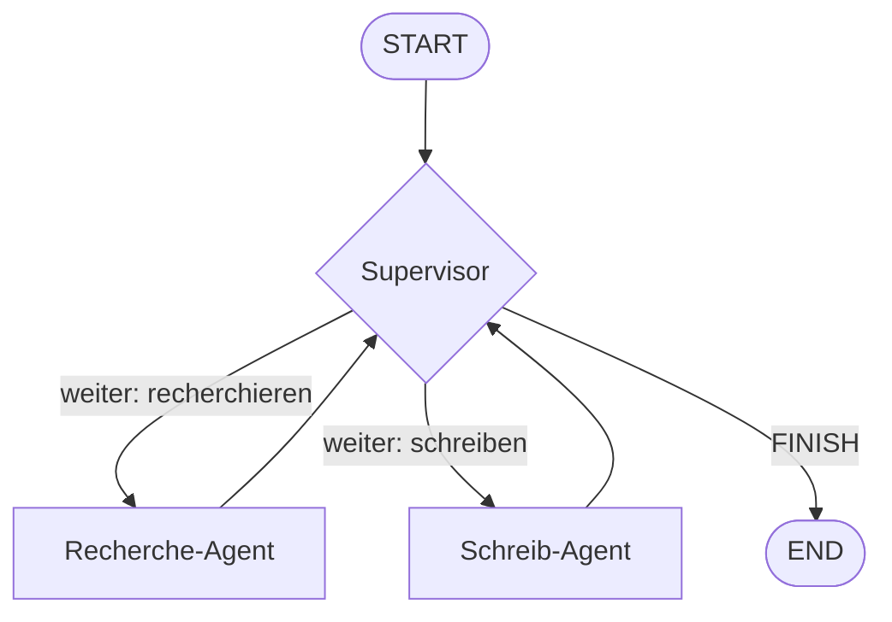

# Aufgabe 7.3 – Der Supervisor: Chef der Agenten 👔

## Schwierigkeit
Fortgeschritten · ⚠️ **Kosten:** LLM-Call pro Runde nur mit Key (offline: Entscheidung simuliert)

## Lernziel
Du baust das wichtigste Multi-Agenten-Muster: Ein **Supervisor** (LLM-Knoten) sieht den Auftrag, entscheidet, welcher Fach-Agent als Nächstes arbeitet, sammelt deren Ergebnisse und beendet, wenn alles erledigt ist.

## Warum ist das wichtig?
Direkte Agent-zu-Agent-Netze werden schnell chaotisch (jeder redet mit jedem). Der Supervisor ist das bewährte Gegenmittel: **eine zentrale Steuerung**, die Arbeit delegiert – wie eine Projektleitung. Fast alle echten Multi-Agent-Systeme (inkl. Stufe 8, Projekt C) sind Supervisor-Systeme.

## Das Konzept einfach erklärt

**Metapher – die Projektleitung:** Sie hält den Master-Plan (State), teilt Einzelaufträge an Spezialisten zu, nimmt deren Berichte entgegen und entscheidet: noch ein Spezialist? Oder: Projekt fertig (FINISH). Die Spezialisten reden **nie direkt miteinander** – alle Kommunikation läuft über sie.

## Die technische Erklärung
- Der **Supervisor ist ein LLM-Node**: Er erhält (a) die Aufgabenliste, (b) alle bisherigen Ergebnisse und (c) die Liste der Mitarbeiter samt Fähigkeiten – und antwortet mit einer **Entscheidung**: welcher Agent als Nächstes oder FINISH.
- **Deterministische Variante** (offline): Die Entscheidung kann auch Regel-Logik sein (Stufe 5.3!) – genau das tut unsere Referenzlösung im Offline-Modus: Mit Key wird dieselbe Node ein echtes LLM fragen.
- Der State enthält: `auftrag`, `naechster_schritt`, `ergebnisse` (Dict pro Agent), `runden` (Loop-Schutz!), `finbericht`.
- **Loop-Schutz ist Pflicht:** Ohne Runden-Limit kann der Supervisor ewig delegieren (Kosten!). Nach `max_runden` erzwingt die Weiche END.

## Voraussetzungen
- Stufe 6 (Agent-Grundlagen), Aufgabe 7.1–7.2

## Deine Mission
Baue `supervisor_workflow.py` – eine Mini-Projektverwaltung mit **zwei** Fach-Agenten:
1. `recherche_agent`: sammelt (simuliert) drei Stichpunkte zum Auftrag (offline: Regel-Logik, mit Key: LLM-Prompt).
2. `schreib_agent`: formuliert aus den Stichpunkten einen Abschlussbericht (simuliert/echt je nach Modus).
3. **Supervisor-Node:** Entscheidung zwischen `recherche_agent` → `schreib_agent` → FINISH. Offline per Regel-Logik („erst recherchieren, dann schreiben, dann fertig"), mit Key als LLM-Aufruf.
4. Loop-Schutz: `max_runden = 5`.
5. Starte mit einem Auftrag („Erstelle eine Kurzdokumentation über RAG") und gib die Ergebnis-Historie aus.

## Akzeptanzkriterien
- [ ] Der Ablauf ist: START → Supervisor → Recherche → Supervisor → Schreiben → Supervisor → FINISH.
- [ ] Ergebnisse der Agenten sammeln sich im State (Dict/Liste).
- [ ] Ohne Key läuft alles (Entscheidung simuliert) – mit Kostentransparenz-Hinweis.
- [ ] `max_runden` begrenzt den Lauf nachweislich (teste mit max_runden=1: dann bricht der Lauf nach dem ersten Agenten ab statt zu endlos delegieren).

## Hinweise
1. Supervisor-Rückgabe: `{"naechster_schritt": "recherche_agent"}` – die Weiche übersetzt in Kanten.
2. Die Ergebnisse-Liste macht den Fortschritt sichtbar: `ergebnisse.append(...)` → im State als neue Liste zurückgeben.
3. Bedingung „FINISH erst wenn Bericht existiert": `if ergebnisse.get("bericht"): return "FINISH"`.

## Reflexionsfragen
1. Warum ist ein Supervisor robust, wo Peer-to-Peer-Agentennetze eskalieren können? (Kommunikationspfade: n·(n−1)/2 vs. n)
2. Was sind die zwei principal failure modes eines Supervisors (Stichworte: Endlos-Delegation, Delegation an den falschen) – und welche zwei Bremsen hast du eingebaut?
3. Wann wäre ein einfacher sequenzieller Graph (Stufe 5) besser als ein Supervisor?

## Häufige Fehler
| Fehler | Lösung |
|---|---|
| Supervisor delegiert endlos | Runden-Zähler + FINISH-Bedingung |
| Ergebnisse verschwinden | neue Liste zurückgeben (Merge!), nicht mutieren |
| Offline läuft es nicht | supervisor-Entscheidung muss ohne LLM funktionieren (Regel-Fallback) |

## Referenzlösung
→ [`solutions/supervisor_workflow.py`](../solutions/supervisor_workflow.py)

## Code-Walkthrough
In der Lösungsdatei; besonders die Supervisor-Entscheidung mit Offline-Fallback und die Weichen-Logik.

## Was haben wir gelernt?
Supervisor-Muster, kollektive Ergebnisse, Loop-Schutz in Multi-Agent-Systemen.

## Was kommt als Nächstes?
**Stufe 8:** Vier echte Projekte vereinen alles – inklusive eines Multi-Agent-Business-Assistenten, der genau dieses Supervisor-Muster in voller Größe nutzt.
