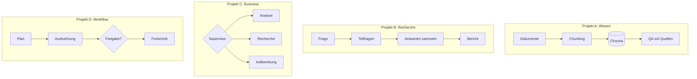

# Stufe 8 – Echte Projekte 🏗️

**Ziel:** Vier vollständige Anwendungen, die alles Vereinte – in **inkrementellen Meilensteinen**, nicht als Codesammlung zum Kopieren.

## Wie du hier arbeitest

Diese Stufe ist anders: Jede Projekt-Datei enthält **Meilensteine** (M1, M2, …). Baue **einen Meilenstein**, teste ihn, vergleiche mit der Lösung – erst dann der nächste. So entsteht ein echtes Verständnis für die *Entstehung* einer Architektur, nicht nur für ihren Endzustand.

## Die Projekte

| Projekt | Thema | Nutzt | Datei |
|---|---|---|---|
| A | **Persönlicher Wissens-Assistent** (RAG komplett) | Stufe 4 | [`tasks/projekt-a-wissens-assistent.md`](tasks/projekt-a-wissens-assistent.md) |
| B | **KI-Recherche-Assistent** (Frage → Teilfragen → Bericht) | Stufe 5–7 | [`tasks/projekt-b-recherche-assistent.md`](tasks/projekt-b-recherche-assistent.md) |
| C | **Multi-Agent-Business-Assistent** (Supervisor-Team) | Stufe 6–7 | [`tasks/projekt-c-business-assistent.md`](tasks/projekt-c-business-assistent.md) |
| D | **Autonomer Workflow-Assistent** (Plan → Ausführung → Fortschritt → Freigabe) | Stufe 6 | [`tasks/projekt-d-workflow-assistent.md`](tasks/projekt-d-workflow-assistent.md) |

**Offline-Modus:** Alle vier Projekte laufen ohne API-Key – Retrieval, Graphen, Freigaben und Fortschritt sind echt; nur die Sprachformulierungen des Modells sind simuliert. Mit Key werden sie zu echten KI-Anwendungen.

## Ausführen

```bash
python3 08-real-world-projects/solutions/knowledge_assistant.py
python3 08-real-world-projects/solutions/research_assistant.py
python3 08-real-world-projects/solutions/business_assistant.py
python3 08-real-world-projects/solutions/workflow_assistant.py
```

## Architekturübersicht



## Danach
[`../09-production/README.md`](../09-production/README.md) macht daraus betriebsfähige Software: Tests, Observability, Sicherheit, Docker – und die Abschluss-Challenge.
