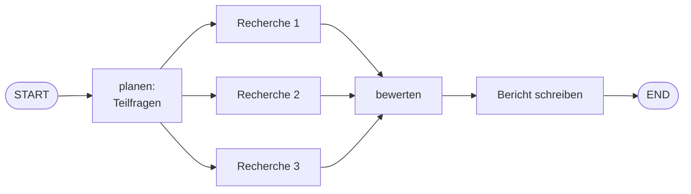

# Projekt B – KI-Recherche-Assistent 🔬

## Schwierigkeit
Fortgeschritten · ⚠️ **Kosten:** mit Key ein LLM-Call pro Teilfrage (offline: komplett kostenlos)

## Lernziel & Warum
Aus **einer** komplexen Forschungsfrage werden automatisch Teilfragen erarbeitet, parallel recherchiert, bewertet und in einen Bericht gegossen. Das ist der Prototyp jedes „Deep-Research"-Tools und vereint Graphdesign, Parallelität und Berichtsgenerierung.

## Konzept

## Deine Mission – in Meilensteinen

**M1 – Planungs-Node:** Zerlegt die Hauptfrage in 3 Teilfragen. Offline deterministisch (fixe Fragetypen: „Was ist X?", „Wie funktioniert X?", „Welche Grenzen hat X?"), mit Key per LLM.

**M2 – Parallele Recherche:** Drei Nodes (aus M1 dynamisch befüllt) recherchieren **parallel** (Stufe 7.1!) je eine Teilfrage und schreiben je eigenes Ergebnis-Feld. Offline: Regel-Fakten (Nutze das Handbuch-Retrieval aus Projekt A als „Wissensquelle"!), mit Key: RAG pro Teilfrage.

**M3 – Bewertungs-Node:** Prüft die Ergebnisse auf Vollständigkeit (alle Felder gefüllt? Mindestlänge?) und markiert `qualitaet_ok`.

**M4 – Berichts-Node + Freigabe:** Schreibt den Bericht (offline: Zusammenführung, mit Key: LLM) – **mit Freigabe-Pflicht** (Stufe 6.4: interrupt) vor der „Veröffentlichung". Fortsetzung per `Command(resume=True)`.

## Akzeptanzkriterien
- [ ] Drei Teilfragen entstehen automatisch aus der Hauptfrage.
- [ ] Die Recherche läuft parallel (eigene Felder pro Zweig!).
- [ ] Der Lauf stoppt vor Veröffentlichung und setzt nach Freigabe fort.
- [ ] Finaler State enthält Bericht + Qualitäts-Flag.

## Hinweise
1. Offline-Faktenquellen: nutze `handbuch_suche`-Retrieval – dann ist sogar die „Recherche" echt!
2. Teilaufgaben-Parallelität: drei Kanten vom Planungs-Node, drei eigene Felder, Merge im Bewertungs-Node.
3. Interrupt + Checkpointer brauchen sich gegenseitig (Stufe 6.4).

## Reflexionsfragen
1. Warum ist „erst planen, dann parallel recherchieren" effizienter als „eine große Frage ans LLM"?
2. Wo würdest du das Budget begrenzen, wenn jede Teilfrage teuer wird?

## Referenzlösung
→ [`solutions/research_assistant.py`](../solutions/research_assistant.py)

## Was haben wir gelernt?
Dynamische Pläne im State, parallele LLM-Arbeit, Qualitätsgates, Freigabe in echten Projekten.
