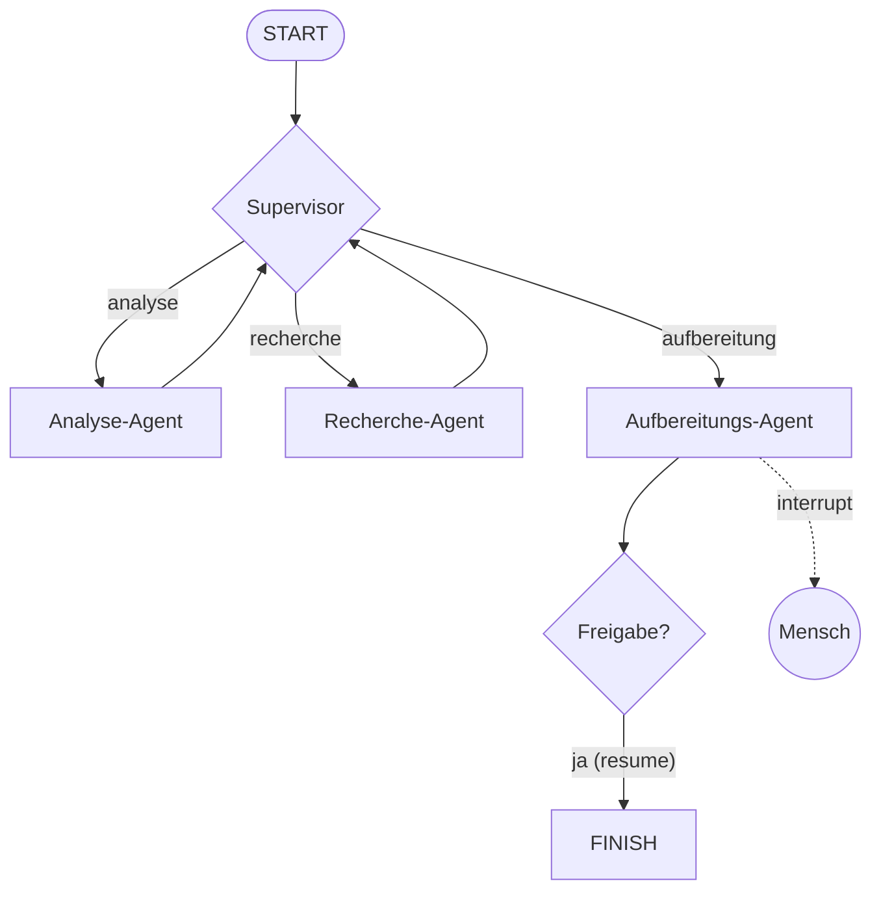

# Projekt C – Multi-Agent-Business-Assistent 👔

## Schwierigkeit
Fortgeschritten · ⚠️ **Kosten:** mit Key ein LLM-Call pro Supervisor-Runde

## Lernziel & Warum
Ein Supervisor koordiniert **drei** Fach-Agenten: Analytiker (versteht die Anfrage), Rechercher (schlägt nach), Aufbereiter (formatiert das Ergebnis). Dazwischen: menschliche Freigabe, bevor das Ergebnis „an den Kunden geht". Das ist das Referenzmuster für Agententeams in der Praxis.

## Konzept

## Deine Mission – in Meilensteinen

**M1 – Drei Fach-Agenten als Nodes:** je eigene Funktion mit klarer Aufgabe (offline: Regel-Logik, mit Key: LLM-Prompts):
- `analyse_agent`: klassifiziert die Anfrage (Typ, Dringlichkeit) → State.
- `recherche_agent`: schlägt über das Handbuch-Retrieval nach → State.
- `aufbereitungs_agent`: baut das fertige Kunden-Ergebnis (E-Mail-Text o. ä.).

**M2 – Supervisor mit Ziellogik:** Delegations-Reihenfolge: Analyse → Recherche → Aufbereitung → FINISH. Erzwinge FINISH bei `max_runden` (Stufe 7.3!).

**M3 – Freigabe vor dem Ergebnis:** Der Aufbereitungs-Agent ruft `interrupt()` **vor** dem „Versenden" – erst `Command(resume=True)` schließt den Vorgang ab (Stufe 6.4).

**M4 – Nachvollziehbarkeit:** Der State protokolliert jede Delegation (`protokoll`) – am Ende ausdrucken.

## Akzeptanzkriterien
- [ ] Der Ablauf ist: Analyse → Recherche → Aufbereitung → Freigabe → FINISH.
- [ ] Ohne Key läuft alles (Regel-Fallbacks), mit Hinweis darauf.
- [ ] Der Lauf pausiert vor dem Ergebnis; Freigabe führt weiter.
- [ ] Das Protokoll zeigt jede Delegation mit Runde.

## Hinweise
1. Gieb jedem Agenten **ein** klar benanntes State-Feld – Schreibkonflikte vermeiden (Stufe 7.1).
2. Der Interrupt muss im Aufbereitungs-Agenten liegen, nicht im Supervisor (der soll weiter delegieren können).
3. Combine-and-reuse: Stufe 7.3 (Supervisor) + 6.4 (Freigabe) + 6.3 (Retrieval).

## Reflexionsfragen
1. Warum genau **drei** Agenten? Was spräche dafür, Analyse und Recherche zu einem Agenten zu verschmelzen – und was dagegen?
2. Was passiert, wenn der Supervisor „vergisst", die Analyse zu beauftragen? Wie schützt dein Design davor (State-Voraussetzungen in der Delegations-Logik)?

## Referenzlösung
→ [`solutions/business_assistant.py`](../solutions/business_assistent.py) – Hinweis: Datei heißt `business_assistant.py`.

## Was haben wir gelernt?
Vollständiges Supervisor-Team, Freigabe im Team-Kontext, Buchhaltung über Delegationen.
