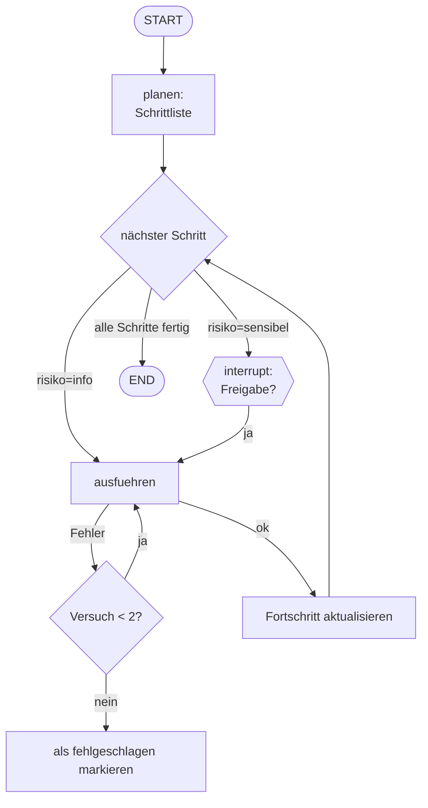

# Projekt D – Autonomer Workflow-Assistent 🤖📋

## Schwierigkeit
Fortgeschritten · ⚠️ **Kosten:** LLM-Calls nur mit Key

## Lernziel & Warum
Der Assistent nimmt einen natürlichsprachlichen Auftrag („Schick dem Team den Wochenbericht und lege eine Notiz an"), **plant** die nötigen Schritte, **führt sie aus**, **verfolgt Fortschritt**, **holt Freigabe** für riskante Schritte ein und **erholt sich von Fehlern**. Das ist die Blaupause für autonome KI-Automatisierung – inklusive aller Sicherheitsbremsen.

## Konzept

## Deine Mission – in Meilensteinen

**M1 – Planungs-Node:** Erzeugt aus dem Auftrag eine **Schrittliste** im State. Offline: bekannte Schlüsselwörter („notiz", „bericht", „e-mail") werden zu Schritten; mit Key: LLM plant.

**M2 – Ausführungs-Loop:** Ein Node nimmt den nächsten offenen Schritt, „führt ihn aus" (simuliert: Funktion pro Schritttyp – `notiz_anlegen`, `bericht_erstellen`, `e_mail_versenden`), markiert ihn `erledigt` oder `fehlgeschlagen`.

**M3 – Freigabe für sensible Schritte:** Schritte mit `risiko="sensibel"` (z. B. E-Mail versenden) pausieren den Lauf per `interrupt()` – Fortsetzung mit `Command(resume=True)`.

**M4 – Fehlererholung:** Schlägt ein Schritt fehl (simuliert: Schritttyp `"fehler_test"` oder zufälliger Ausfall), wird er **einmal** wiederholt; erst dann gilt er als fehlgeschlagen – und der Workflow **läuft weiter** mit den übrigen Schritten.

**M5 – Fortschritt & Abschluss:** Der State hält `schritte` (mit Status je Schritt) und `protokoll`; am Ende Ausgabe: was lief, was failed, was übrig blieb.

## Akzeptanzkriterien
- [ ] Der Plan entsteht automatisch aus dem Auftrag (mindestens 2–3 Schritte).
- [ ] Sensible Schritte stoppen für die Freigabe und werden erst danach ausgeführt.
- [ ] Ein Fehlschlag wird genau einmal wiederholt und dann sauber markiert – ohne Crash.
- [ ] Das Abschluss-Protokoll zeigt den Zustand jedes Schritts.

## Hinweise
1. Schrittliste im State: `[{"name": ..., "typ": ..., "risiko": ..., "status": "offen"}, ...]`
2. Loop-Schutz: Schrittzahl ist natürlich begrenzt; trotzdem maximal 1 Wiederholung pro Schritt erzwingen.
3. Wiederverwendung: Freigabe aus Stufe 6.4, Loop aus Stufe 5.4, Planung = „klassifizieren light".

## Reflexionsfragen
1. Welche Schritte würdest du in der echten Welt **nie** automatisch ausführen – egal wie gut das LLM plant?
2. Warum ist „Fehler → einmal wiederholen → weitermachen" besser als „Fehler → harter Abbruch"? Wann wäre Abbruch trotzdem richtig?

## Referenzlösung
→ [`solutions/workflow_assistant.py`](../solutions/workflow_assistant.py)

## Was haben wir gelerst?
Plan-Ausführungs-Architektur, Risiko-Klassen, robuste Fehlererholung, lückenlose Protokollierung – das Handwerk für autonome Systeme **mit** Sicherheitsgurt.
