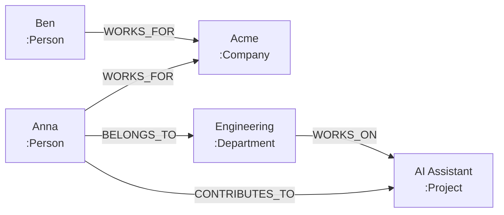

# Stufe 10 – Knowledge-Graph-Fundamente 🕸️

**Ziel:** Du verstehst, was ein Knowledge Graph ist – und baust deinen ersten **in reinem Python**, ganz ohne Datenbank.

## Was ist ein Knowledge Graph?

Bislang hast du Wissen als **Text** gespeichert (RAG, Stufe 4): Dokumente werden gechunkt, geembeddet und semantisch gesucht. Ein Knowledge Graph (KG) stattdessen speichert Wissen als **Fakten mit Verbindungen**:

**Metapher – der Stammbaum vs. der Familienbuch-Kapitel:** Ein Buch über deine Familie beschreibt alles in Fließtext (→ Vektor-RAG findet „sinngleiche" Absätze). Ein Stammbaum zeigt **exakt**, wer mit wem verwandt ist – Verbindungen sind Daten erster Klasse, nicht Text.

Das Firmen-Beispiel aus dem ersten Kapitel:



Gespeicherte Fakten: „Anna WORKS_FOR Acme", „Anna BELONGS_TO Engineering", „Engineering WORKS_ON AI Assistant". Die Stärke: Du kannst **fragen**, was im Text nirgends wörtlich steht: *„Arbeitet jemand an AI Assistant, der zu Engineering gehört?"* – durch traversal (Folgen der Kanten).

## Kernbegriffe

| Begriff | Bedeutung | Metapher |
|---|---|---|
| **Entität** | Ein Ding: Person, Firma, Projekt | Ein Kartenei im Karteikasten |
| **Node (Knoten)** | Die Repräsentation der Entität im Graph | Die Karte selbst |
| **Label** | Typ des Nodes (:Person, :Company) | Farbkodierung der Karten |
| **Property** | Attribut (`name: "Anna"`) | Notiz auf der Karte |
| **Relationship** | Gerichtete, benannte Verbindung (WORKS_FOR) | Faden zwischen zwei Karten |
| **Traversal** | Kanten folgen, um Muster zu finden | Den Fäden nachgehen |

## Aufgaben

| # | Aufgabe | Schwierigkeit | DB nötig? |
|---|---|---|---|
| 10.1 | [`tasks/01-erster-graph.md`](tasks/01-erster-graph.md) – Graph in Python-Dictionaries | Anfänger | nein |
| 10.2 | [`tasks/02-nodes-labels-properties.md`](tasks/02-nodes-labels-properties.md) – Entitäten, Labels, Properties | Anfänger | nein |
| 10.3 | [`tasks/03-beziehungen-und-abfragen.md`](tasks/03-beziehungen-und-abfragen.md) – Beziehungen + Python-Abfragen | Leicht | nein |
| 10.4 | [`tasks/04-visualisierung.md`](tasks/04-visualisierung.md) – Mermaid & Traversierung | Leicht | nein |

Alle Aufgaben nutzen den `GraphStore` aus `lernakademie/graph_store.py` – **der Offline-Pendant zu Neo4j**, den du in Stufe 11 kennenlernst. So lernst du die *Konzepte* zuerst ohne Installation.

## Ausführen

```bash
python3 10-knowledge-graph-fundamentals/solutions/first_graph.py
python3 10-knowledge-graph-fundamentals/solutions/graph_queries.py
python3 10-knowledge-graph-fundamentals/solutions/visualize_graph.py
```

## Danach
Weiter mit [`../11-graph-databases/README.md`](../11-graph-databases/README.md): dieselben Konzepte in einer echten Graph-Datenbank (Neo4j + Cypher).
