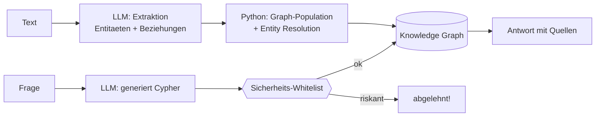

# Stufe 12 – Knowledge Graphs & LLMs 🧠🕸️

**Ziel:** Der Graph füllt sich **selbst**: Ein LLM extrahiert aus natürlichem Text Entitäten und Beziehungen, und du befragst den Graph per natürlicher Frage – mit Sicherheitsnetz gegen gefährliche generierte Abfragen.

## Warum ist das mächtig?

Bislang haben **wir** den Graph von Hand gebaut (Stufe 10/11). Jetzt dreht sich das um: Du gibst Text hinein – das LLM erkennt „wer/was/verbindet" – Python übersetzt das in Nodes und Kanten. Das ist der Kern jedes automatischen Wissensmanagements (Firmen-Wiki → Graph, News → Graph, E-Mails → Graph).



## Die zwei großen Risiken (und unsere Bremsen)

1. **Generierte Abfragen sind Angriffsfläche.** Ein LLM kann (per Prompt-Injection!) zu `DELETE`-Abfragen verleitet werden. Bremse: **Whitelist vor jeder Ausführung** – nur lesende `MATCH...RETURN` (→ `ist_sicher()`).
2. **Doppelte Entitäten.** „Acme" vs. „ACME" vs. „Acme GmbH" – ohne **Entity Resolution** wird der Graph Müll. Bremse: `find_node` vor jedem Anlegen.

## Aufgaben

| # | Aufgabe | Schwierigkeit | API? |
|---|---|---|---|
| 12.1 | [`tasks/01-extraktion.md`](tasks/01-extraktion.md) – Entitäten & Beziehungen aus Text | Leicht | ⚠️ mit Key echt, offline Regel-Fallback |
| 12.2 | [`tasks/02-graph-population.md`](tasks/02-graph-population.md) – Extraktion → Graph (Entity Resolution) | Leicht | offline voll übbar |
| 12.3 | [`tasks/03-natuerliche-sprache-zu-cypher.md`](tasks/03-natuerliche-sprache-zu-cypher.md) – Frage → Cypher → Antwort, mit Sicherheitsnetz | Mittel | ⚠️ / offline |

## Ausführen

```bash
python3 12-graphs-und-llms/solutions/extract_to_graph.py
python3 12-graphs-und-llms/solutions/nl_to_cypher.py
```

**Offline-Modus:** Die Extraktion nutzt einen Regel-Fallback (bekannte Namen/Muster), die Frage→Cypher-Übersetzung ebenso – so ist die komplette Pipeline ohne Key erlebbar. Mit Key extrahiert und formuliert Mistral echt.

## Danach
Weiter mit [`../13-graphrag/`](../13-graphrag/README.md): Vektor-RAG und Graph-Retrieval im direkten Vergleich – und die Hybrid-Kombination.
