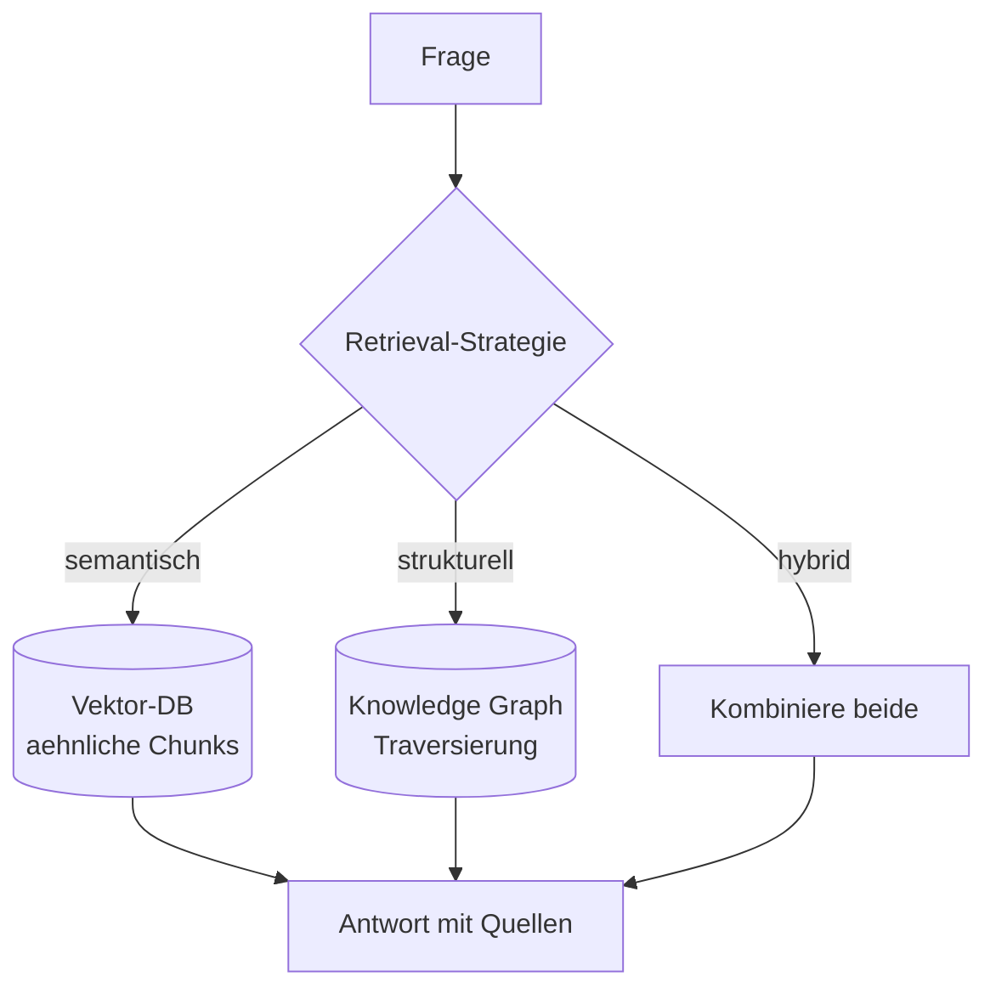

# Stufe 13 – GraphRAG: Vektor-RAG trifft Knowledge Graph 🔀

**Ziel:** Du vergleichst **Vektor-Retrieval** (Stufe 4) mit **Graph-Retrieval** (Stufe 12) auf denselben Fragen – und baust **Hybrid-Retrieval**, die beides kombiniert.

## Die Kernfrage: Wann welche Retrieval-Art?

| Frage | Gewinner | Warum? |
|---|---|---|
| „Was steht in den Handbüchern zu Urlaub?" | **Vektor** | sinngleiche Textstellen finden, egal wie formuliert |
| „Wer arbeitet alles an AI Assistant?" | **Graph** | exakte Traversierung der WORKS_ON/CONTRIBUTES_TO-Kanten |
| „Wie hängt Anna mit dem Projekt zusammen?" | **Graph** | Pfadsuche ist strukturell, kein Text beschreibt den Weg |
| „Was wissen wir GESAMT über das Projekt?" | **Hybrid** | Dokumente (Kontext) + Graph (Beziehungen) zusammen |

**Metapher – Bibliothek mit zwei Abteilungen:** Die Vektor-Abteilung ist der hilfsbereite Ausleiher: „Ich glaube, *dieses* Kapitel meinst du" (unscharf, nach Bedeutung). Die Graph-Abteilung ist der Archivar mit dem Aktenzeichen-System: „Alles, was mit X zusammenhängt, hängt an *diesem* Faden" (exakt, nach Struktur). Die Hybrid-Abteilung fragt beide und legt die Ergebnisse zusammen auf den Tisch.



## Aufgaben

| # | Aufgabe | Schwierigkeit | API? |
|---|---|---|---|
| 13.1 | [`tasks/01-vektor-vs-graph.md`](tasks/01-vektor-vs-graph.md) – Vergleich auf denselben Fragen | Mittel | offline voll übbar |
| 13.2 | [`tasks/02-hybrid-retrieval.md`](tasks/02-hybrid-retrieval.md) – beide Quellen kombinieren | Mittel | offline voll übbar |

## Ausführen

```bash
python3 13-graphrag/solutions/vector_vs_graph.py
python3 13-graphrag/solutions/hybrid_retrieval.py
```

Beide Lösungen laufen komplett offline (Vektor-Embeddings = Stufe-4-Keyword-Modell, Graph = GraphStore). Die **Wissensdaten** liegen in [`data/`](data/): dasselbe Firmenszenario einmal als Text (für Vektor), einmal als Graph (für Traversierung) – so ist der Vergleich fair und nachvollziehbar.

## Danach
Weiter mit [`../14-graph-agents/`](../14-graph-agents/README.md): Ein Agent entscheidet selbst, welche Retrieval-Strategie die Frage braucht.
