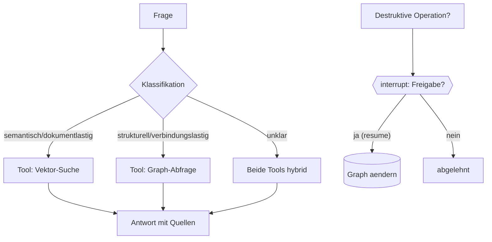

# Stufe 14 – Graph-Aware Agents: der Hybride als Agent 🤖🕸️

**Ziel:** Ein LangGraph-Agent erhält **zwei Retrieval-Werkzeuge** (Vektor, Knowledge Graph) und entscheidet selbst, welches er braucht – plus Freigabe-Pflicht für destruktive Graph-Operationen.

## Die entscheidende Architektur-Idee

> **Der Knowledge Graph ist externes, strukturiertes Wissen. LangGraph kontrolliert den Workflow des Agenten.**

Das Agenten-Gehirn (LangGraph) und das Agenten-Wissen (Graph + Vektor-DB) sind **getrennte Systeme** – der Agent greift über Tools zu. Das macht beides austauschbar und testbar (du kennst jedes Muster bereits: Tools aus Stufe 6, Supervisor-Routing aus Stufe 7, Freigabe aus 6.4).



## Wann Agent – wann deterministisches Routing?

Wie in Stufe 6: Wenn die Fragen-Arten **endlich und bekannt** sind („immer entweder Dokument- oder Graph-Frage"), reicht eine Regel-Klassifikation (billig, prüfbar). Ein LLM-Klassifizierer lohnt sich, wenn Fragen **frei formuliert** sind und die Zuordnung unscharf wird. Beides baust du hier – dieselbe Pipeline, austauschbares Klassifikations-Hirn.

## Aufgaben

| # | Aufgabe | Schwierigkeit | API? |
|---|---|---|---|
| 14.1 | [`tasks/01-graph-aware-agent.md`](tasks/01-graph-aware-agent.md) – Agent mit beiden Retrieval-Tools | Mittel | offline voll übbar |
| 14.2 | [`tasks/02-freigabe-fuer-graph-operationen.md`](tasks/02-freigabe-fuer-graph-operationen.md) – Freigabe vor destruktiven Ops | Mittel | offline voll übbar |

## Ausführen

```bash
python3 14-graph-agents/solutions/graph_aware_agent.py
python3 14-graph-agents/solutions/approval_graph_ops.py
```

## Danach
Weiter mit [`../15-frontend/README.md`](../15-frontend/README.md): Du gibst allem ein Gesicht – und danach dem Capstone-Projekt (`final-project/knowledge-research-agent/`), das alle Fäden zusammenführt.
