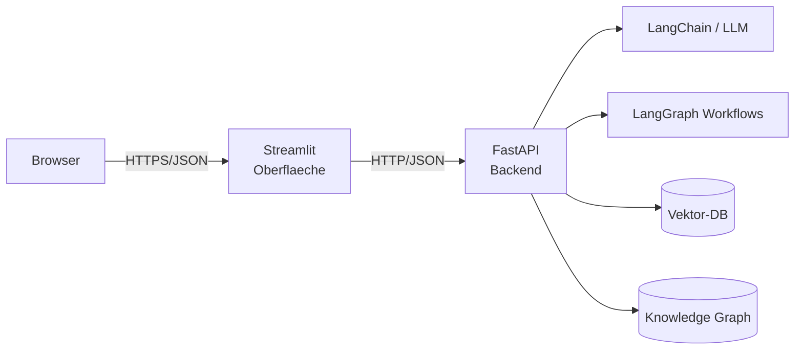

# Stufe 15 – Frontend: dein Agent bekommt ein Gesicht 🖥️

**Ziel:** Du verstehst, wie eine **Web-Oberfläche** mit deinem Python-Backend zusammenarbeitet – und bedienst deine KI-Anwendungen über eine echte Benutzeroberfläche statt Kommandozeile.

## Wichtig: Was du hier lernst – und was NICHT

> **Du wirst KEIN Frontend-Entwickler.** Diese Stufe vermittelt die **Konzepte** (Wie redet UI mit Python?), liefert lauffähigen Code und erklärt ihn auf Augenhöhe. Die finale Anwendung (final-project) ist ein **fertiges Werkzeug zum Experimentieren** – genau wie ein Physik-Labor nicht verlangt, dass du das Oszilloskop selbst baust.

| Du musst VERSTEHEN | Du baust SELBST (klein) | FERTIG geliefert |
|---|---|---|
| Was eine API ist und warum sie zwischen UI und Python steht | Ein minimaler FastAPI-Endpunkt | Das komplette Capstone-Frontend |
| Was Request/Response/JSON ist | Eine Mini-Streamlit-Seite | Graph-Visualisierung (PyVis) |
| Wie Sitzungen/Verlauf funktionieren | – | Agent-Playground, Freigabe-UI |
| Warum Geheimnisse nie im Frontend landen | – | Deployment-Konfiguration |

## Die Architektur auf einen Blick



**Warum Streamlit?** (unsere Bewertung)
- **Reines Python** – kein HTML/CSS/JS-Lernen nötig (0 % JS in dieser Akademie!)
- **Schnellster Weg** von Skript zu klickbarer App (eine Datei genügt)
- **Ideal für Experimente**: Widgets (Slider, Buttons) wie `input()` mit Maus
- **Bewusste Grenze:** Für echte Produktion (viele Nutzer, Login-Systeme) lernt man später React & Co. – deshalb trennen wir sauber: **Backend-Logik in FastAPI bleibt identisch**, das Frontend ist austauschbar.

**Warum FastAPI als Zwischenschicht?** Streamlit könnte Python direkt aufrufen – aber mit FastAPI dazwischen:
1. Frontend ist **austauschbar** (Streamlit heute, Web-App morgen, Handy-App übermorgen)
2. Geheimnisse & schwere Logik liegen **nur im Backend**
3. Du kannst die API mit `curl`/Tests ansprechen, ohne UI

## Aufgaben

| # | Aufgabe | Schwierigkeit | Fokus |
|---|---|---|---|
| 15.1 | [`tasks/01-fastapi-grundlagen.md`](tasks/01-fastapi-grundlagen.md) – dein erster API-Endpunkt | Leicht | Backend verstehen |
| 15.2 | [`tasks/02-streamlit-chat.md`](tasks/02-streamlit-chat.md) – erste Chat-Oberfläche | Leicht | UI bauen & koppeln |
| 15.3 | [`tasks/03-architektur-und-sicherheit.md`](tasks/03-architektur-und-sicherheit.md) – Konzepte vertiefen | Mittel | Konzepte |

Die **fertige Groß-Anwendung** (Chat, Graph-Explorer, Agent-Playground, Freigaben, Prompt-Labor) ist dann das Capstone: [`../final-project/knowledge-research-agent/`](../final-project/knowledge-research-agent/README.md)

## Ausführen

```bash
# Loesung 15.1 (API-Server):
uvicorn 15-frontend/solutions/api_server:app --reload
# dann im Browser: http://localhost:8000/docs

# Loesung 15.2 (Streamlit-Chat):
streamlit run 15-frontend/solutions/chat_app.py
```

## Danach
Das große Finale: [`../final-project/knowledge-research-agent/`](../final-project/knowledge-research-agent/README.md) – dein komplettes persönliches Wissens- & Recherche-System mit Docker Compose.
