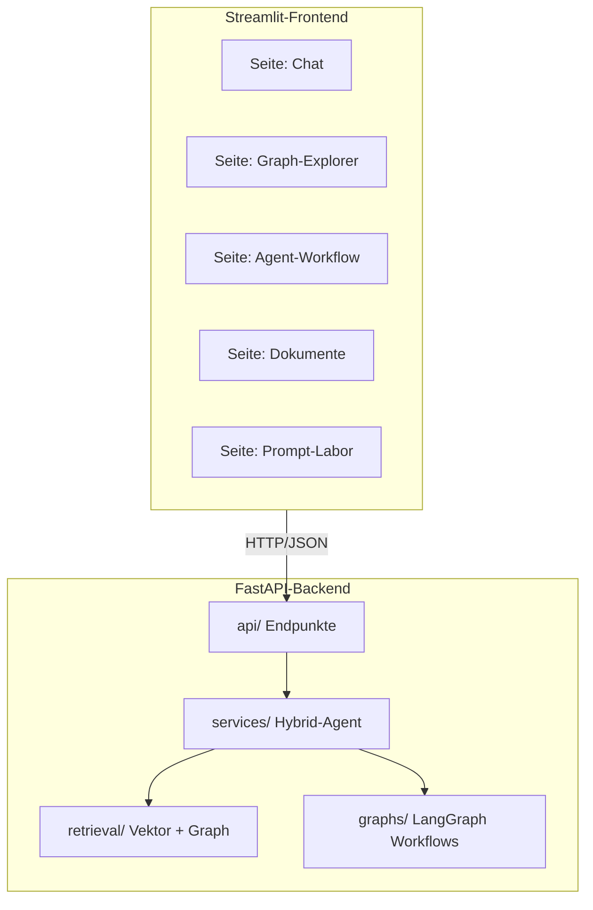

# Aufgabe 15.3 – Architektur & Sicherheit von Frontend-Systemen 🏛️🔐

## Schwierigkeit
Mittel · **Kosten: keine**

## Lernziel
Du verstehst die System-Entscheidungen hinter dem Capstone: Warum drei Schichten, wie Sessions verwaltet werden, wie Human-in-the-Loop übers Web funktioniert, und wo die Risiken liegen.

## Warum ist das wichtig?
Das Capstone-Frontend wirst du nutzen wie ein Werkzeug – aber als Ingenieur musst du erklären können, **warum** es so gebaut ist. Diese Aufgabe ist Lektüre + Reflexion + kleine Experimente an der echten Capstone-Anwendung. Sie bereitet dich aufs „Erklären können" vor (Definition of Success der Akademie!).

## Die Architektur des Capstone im Überblick

## Die sieben Konzepte (Lektüre + Nachweis-Experimente)

**1. Schichten-Trennung.** UI (Streamlit) kennt kein LLM, kein API-Key; Backend kennt keine Widgets. Nachweis: Öffne `final-project/knowledge-research-agent/frontend/app.py` und suche nach `MISTRAL_API_KEY` – du wirst ihn **nicht** finden.

**2. Sessions & Verlauf.** Das Backend hält pro `session_id` den Verlauf (genau wie dein Chatbot Stufe 2.4 – nur im Server). Nachweis: Capstone-Chat, Seite neu laden → Verlauf bleibt.

**3. Human-in-the-Loop übers Web.** Der `interrupt()` aus Stufe 6.4 pausiert den Workflow **im Backend**; das Frontend zeigt den Freigabe-Dialog und schickt `resume=True/False` als normale Antwort. Nachweis: Capstone „Fakt vorschlagen" → Dialog → ablehnen → Graph unverändert.

**4. API-Sicherheit (Baseline).** Key nur im Backend (.env), Pydantic-Validierung an jedem Endpunkt, lesende Whitelist für Graph-Zugriff (Stufe 12.3), Freigabe-Pflicht für Schreiben (Stufe 14.2). Was hier (bewusst) fehlt: echte Authentifizierung (Login) – **lokal** okay, **online** Pflicht (Stufe-9-Wissen: Angriffsfläche).

**5. Fehler-Strategie.** Backend-Fehler werden als HTTP-Status + deutsche Meldung übermittelt; das Frontend zeigt sie freundlich. Kein Traceback erreicht den Nutzer. Nachweis: Backend stoppen, Frontend öffnen → saubere Fehlermeldung.

**6. Offline/Online-Modus als Systemmerkmal.** Der Modus-Schalter (key vorhanden oder nicht) muss **beim Start** erkennbar sein (Status-Endpunkt) und jede Antwort kennzeichnen (`[OFFLINE]`-Prefix). Nachweis: Capstone ohne Key starten → Modusanzeige „offline", alle Features nutzbar.

**7. Austauschbarkeit.** Das Backend ist die einzige „Wahrheit" – morgen könnte ein React-Frontend dieselben Endpunkte nutzen, oder ein Handy-Client. Nachweis (Konzept): Alle Features sind über die API in `docs/` mit curl erreichbar – ohne Streamlit.

## Deine Mission

1. **Lektüre:** Capstone-README (`final-project/knowledge-research-agent/README.md`) + Code-Ordner-Struktur erfassen (api/agents/graphs/retrieval/services).
2. **Nachweis-Experimente** (lokal, offline, ~30 Minuten): Die Konzept-Nachweise 1, 3, 4, 6 ausführen – jeweils 2–3 Sätze Beobachtung notieren.
3. **Architektur-Skizze:** Zeichne (auf Papier oder Mermaid) den Weg einer Frage von der Eingabe bis zur Antwort – mit den vier beteiligten Schichten.
4. **Reflexions-Notizen:** Beantworte die Reflexionsfragen schriftlich für dich – sie sind deine „Verteidigung" des Systems.

## Akzeptanzkriterien
- [ ] Alle vier Nachweis-Experimente durchgeführt und dokumentiert.
- [ ] Die Architektur-Skizze zeigt: UI → API → Services → Retrieval/Graphs.
- [ ] Du kannst auf Fragen wie „Warum kein Key im Frontend?" mit 2 Sätzen antworten.

## Reflexionsfragen
1. Warum würde „Streamlit ruft direkt LangGraph auf" in der Doku schneller sein – und warum ist es trotzdem die falsche Architektur für alles, was größer wird?
2. Ein Kollege sagt: „Interrupts sind doch was für Konsolen-Apps – im Web kann man nicht pausieren!" Widerlege ihn in 3 Sätzen (Stichwort: Checkpointer + Resume über Request).
3. Was müsste passieren, bevor diese Anwendung öffentlich (Internet) gehen darf? (Nenne 5 Punkte – Stufe 9 hilft!)

## Referenzlösung
→ [`solutions/architektur_notizen.md`](../solutions/architektur_notizen.md)

## Was haben wir gelernt?
Vollständiges Architektur-Verständnis der Ziel-Anwendung.

## Was kommt als Nächstes?
🎓 **Das Finale:** [`final-project/knowledge-research-agent/`](../../final-project/knowledge-research-agent/README.md) – die komplette Anwendung ausführen, benutzen, verstehen. Der Abschluss deiner Akademie-Reise.
