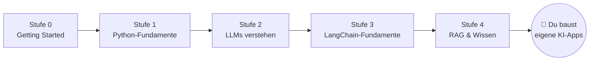

# 🗺️ Lernfahrplan

## Der Pfad durch Stufe 0–4 (der aktuelle Umfang dieser Akademie)

**Regel:** Arbeite die Stufen in dieser Reihenfolge durch. Jede Aufgabe baut auf Konzepten der vorherigen auf.

| Stufe | Was du lernst | Abhängigkeiten | Meilenstein |
|---|---|---|---|
| **0 – Getting Started** | Python installieren, Terminal, erste Skripte, Variablen, Eingaben | keine | Hello World + personalisierte Begrüßung |
| **1 – Python-Fundamente** | Listen, Dictionaries, Funktionen, Imports, venv, Pakete, `.env`, API-Keys | Stufe 0 | Mini-Projekt „Persönlicher Assistent" (reine Logik) |
| **2 – LLMs verstehen** | KI vs. klassische Logik, Tokens, Kontextfenster, Nachrichten-Rollen, Temperatur, Kosten, erste Mistral-API-Calls | Stufe 1 | Kommandozeilen-Chatbot |
| **3 – LangChain-Fundamente** | Chat-Modelle, Prompt-Templates, Runnable-Schnittstelle, Chains, Output-Parser, strukturierte Ausgaben (Pydantic), Fehlerbehandlung | Stufe 2 | Content-Assistant |
| **4 – RAG & Wissen** | Dokumente, Loader, Text-Splitting/Chunking, Embeddings, Vektor-Datenbanken (Chroma), Similarity Search, Retrieval-Chains, Halluzinationen | Stufe 3 | Dokumenten-QA-Assistent |

## Die Vision: Stufe 5–9 (in Arbeit)

| Stufe | Thema | Warum danach? |
|---|---|---|
| **5 – LangGraph-Fundamente** | Graphen, State, Nodes, Edges, konditionales Routing, Loops | Ketten (Chains) sind gerade Linien; echte Workflows haben Verzweigungen und Schleifen |
| **6 – KI-Agenten** | Tools, Tool-Calling, Agent-Loops, Memory, Checkpointing, Human-in-the-Loop | Ein Agent *entscheidet selbst*, welche Schritte nötig sind |
| **7 – Fortgeschrittenes LangGraph** | Supervisor, Subgraphs, Parallelität, Persistenz, Streaming, Fehlertoleranz | Echte Systeme verteilen Arbeit auf mehrere Agenten |
| **8 – Echte Projekte** | Wissens-Assistent, Research-Assistant, Business-Assistent, autonomer Workflow | Der Transfer in die Praxis |
| **9 – Produktion** | Testing, Evaluierung, LangSmith, Sicherheit, Kosten, Docker | Von „läuft bei mir" zu „läuft zuverlässig" |

## Wie viel Zeit brauche ich?

Erfahrungswert für Anfänger:innen mit 30–60 Minuten pro Tag:

- Stufe 0: ~1 Woche
- Stufe 1: ~2 Wochen
- Stufe 2: ~1 Woche
- Stufe 3: ~2 Wochen
- Stufe 4: ~2 Wochen

Nimm dir die Zeit. **Verstehen schlägt Tempo.**
