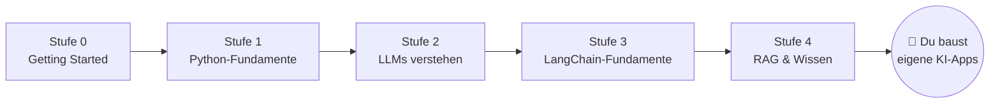

# 🗺️ Lernfahrplan

## Der Pfad durch alle Stufen 0–9

**Regel:** Arbeite die Stufen in dieser Reihenfolge durch. Jede Aufgabe baut auf Konzepten der vorherigen auf.

| Stufe | Was du lernst | Abhängigkeiten | Meilenstein |
|---|---|---|---|
| **0 – Getting Started** | Python installieren, Terminal, erste Skripte, Variablen, Eingaben | keine | Hello World + personalisierte Begrüßung |
| **1 – Python-Fundamente** | Listen, Dictionaries, Funktionen, Imports, venv, Pakete, `.env`, API-Keys | Stufe 0 | Mini-Projekt „Persönlicher Assistent" (reine Logik) |
| **2 – LLMs verstehen** | KI vs. klassische Logik, Tokens, Kontextfenster, Nachrichten-Rollen, Temperatur, Kosten, erste Mistral-API-Calls | Stufe 1 | Kommandozeilen-Chatbot |
| **3 – LangChain-Fundamente** | Chat-Modelle, Prompt-Templates, Runnable-Schnittstelle, Chains, Output-Parser, strukturierte Ausgaben (Pydantic), Fehlerbehandlung | Stufe 2 | Content-Assistant |
| **4 – RAG & Wissen** | Dokumente, Loader, Text-Splitting/Chunking, Embeddings, Vektor-Datenbanken (Chroma), Similarity Search, Retrieval-Chains, Halluzinationen | Stufe 3 | Dokumenten-QA-Assistent |

## Stufen 10–15 + Capstone (Erweiterung: Knowledge Graphs & Frontend)

| Stufe | Ordner | Meilenstein |
|---|---|---|
| **10 – KG-Fundamente** | `10-knowledge-graph-fundamentals/` | Graph in reinem Python (GraphStore) |
| **11 – Graph-Datenbanken** | `11-graph-databases/` | Neo4j + Cypher (mit Offline-Fallback) |
| **12 – Graphs & LLMs** | `12-graphs-und-llms/` | LLM-Extraktion, NL→Cypher (Whitelist) |
| **13 – GraphRAG** | `13-graphrag/` | Vektor vs. Graph vs. Hybrid |
| **14 – Graph-Aware Agents** | `14-graph-agents/` | Routing-Agent + Freigabe-Schreibschutz |
| **15 – Frontend** | `15-frontend/` | FastAPI + Streamlit-Konzepte |
| **Capstone** | `final-project/knowledge-research-agent/` | komplette App mit Frontend & Docker |

## Stufen 5–9 (alle ausgebaut)

| Stufe | Ordner | Meilenstein |
|---|---|---|
| **5 – LangGraph-Fundamente** | `05-langgraph-fundamentals/` | eigener Graph mit Routing + Loop |
| **6 – KI-Agenten** | `06-ai-agents/` | Agent mit Tools, Memory, Freigabe |
| **7 – Fortgeschrittenes LangGraph** | `07-advanced-langgraph/` | Supervisor-Multi-Agent-System |
| **8 – Echte Projekte** | `08-real-world-projects/` | 4 vollständige Anwendungen |
| **9 – Produktion** | `09-production/` | getestete, dockerisierte Abschluss-Challenge |

## Wie viel Zeit brauche ich?

Erfahrungswert für Anfänger:innen mit 30–60 Minuten pro Tag:

- Stufe 0: ~1 Woche
- Stufe 1: ~2 Wochen
- Stufe 2: ~1 Woche
- Stufe 3: ~2 Wochen
- Stufe 4: ~2 Wochen
- Stufen 5–9: ~6–8 Wochen
- Stufen 10–15 + Capstone: ~4–6 Wochen

Nimm dir die Zeit. **Verstehen schlägt Tempo.**
