# 🗺️ Lernfahrplan – Notebooks & Build It 3 Times

## Der Weg (eine Datei pro Lektion, alles im Notebook)

```mermaid
flowchart LR
    S["START_HERE.ipynb"] --> M1["01-02<br/>Python-Basics"]
    M1 --> M2["03-04<br/>LLM & Chatbot"]
    M2 --> B1["🧱 05-06<br/>BUILD 1<br/>Pure Python"]
    B1 --> M3["07-08<br/>LangChain & RAG"]
    M3 --> B2["🔗 09<br/>BUILD 2<br/>Vektor-RAG"]
    B2 --> KG["10-12<br/>Knowledge Graphs"]
    KG --> LG["13-14<br/>LangGraph"]
    LG --> B3["🚀 15<br/>BUILD 3<br/>Hybrid-Agent"]
    B3 --> AG["16-18<br/>Agenten"]
    AG --> FIN["🏁 19<br/>Capstone + Frontend"]
    FIN --> T["20<br/>Testing & Abschluss"]
```

| Lektionen | Meilenstein |
|---|---|
| START_HERE | Setup + erster Erfolg (~15 Min) |
| 01–04 | Python + erster LLM-Call + Chatbot (~3 Std) |
| 05–06 | 🧱 **BUILD 1** – alles von Hand verstehen (~2 Std) |
| 07–09 | 🔗 **BUILD 2** – semantische Suche, Quellen, Pydantic (~3 Std) |
| 10–12 | Knowledge Graphs (Python → Neo4j → LLM-Extraktion) (~3 Std) |
| 13–15 | 🚀 **BUILD 3** – Routing-Agent + Freigabe (~3,5 Std) |
| 16–18 | Agenten-Vertiefung (Tools, Gedächtnis, Supervisor) (~3 Std) |
| 19–20 | 🏁 Capstone-Systemtest + Frontend + Testing (~2,5 Std) |

**Gesamt:** ~20 Stunden konzentrierte Arbeit – verteilt über Wochen, in deinem Tempo.

## Die drei Builds (das Leitprinzip)

Derselbe **Personal Knowledge Assistant**, dreimal gebaut – jedes Mal mit bewusstem Grund:
Vergleich mit Architektur-Diagrammen, Tabellen und Faustregeln:
[same-problem-three-architectures.md](same-problem-three-architectures.md)
