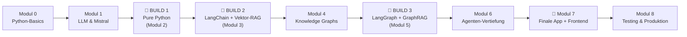

# 🗺️ Lernfahrplan – Build It 3 Times

## Die Kernidee

Ein Beispiel durch die ganze Akademie: der **Personal Knowledge Assistant** – dreimal gebaut, jedes Mal besser. Die volle Gegenüberstellung (Architekturen, Diagramme, Vergleichstabelle, Faustregeln): [„Same Problem, Three Architectures"](same-problem-three-architectures.md).

## Module & Abhängigkeiten

| Modul | Baut auf | Meilenstein |
|---|---|---|
| **0 – Setup** | – | erstes Programm + venv + `.env` |
| **1 – LLMs** | 0 | erster API-Call + Chatbot |
| **2 – 🧱 Build 1** | 1 | Assistent in reinem Python + erste Oberfläche + Schmerz-Doku |
| **3 – 🔗 Build 2** | 2 | RAG-Assistent mit Quellen (Recycling: Oberfläche läuft weiter) |
| **4 – Knowledge Graphs** | 2 (gleiche „erst von Hand"-Philosophie) | Graph + Traversierung + Neo4j/Cypher |
| **5 – 🚀 Build 3** | 3 + 4 | Hybrid-Routing-Agent + Freigaben (wiederverwendet Build-2-Teile!) |
| **6 – Agenten-Vertiefung** | 5 | Tools, Gedächtnis, Supervisor |
| **7 – 🏁 Finale App** | 5 + 6 | komplettes System mit Frontend + Docker |
| **8 – Produktion** | 7 | getestet, sicher, betriebsbereit + Abschluss |

## Zeitaufwand (Richtwerte, 30–60 Min/Tag)

Modul 0–1: ~2 Wochen · Build 1: ~1 Woche · Build 2: ~2 Wochen · Modul 4: ~1 Woche · Build 3: ~2–3 Wochen · Modul 6–8: ~3 Wochen. **Verstehen schlägt Tempo.**

## Was bleibt bewusst weg?

Weniger ist mehr: keine Aufgaben für jede Mini-Variante. Wo frühere Versionen dieses Repositories z. B. vier separate Projekte hatten, konzentriert sich alles auf **ein** Beispiel, das wächst. Gelöschte Inhalte leben in der Git-Historie weiter.
