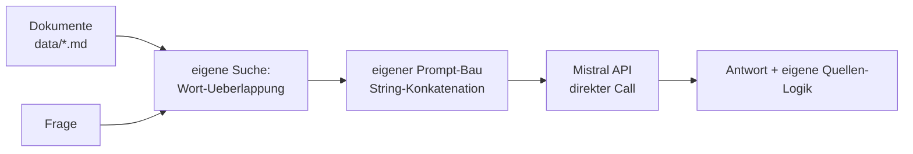
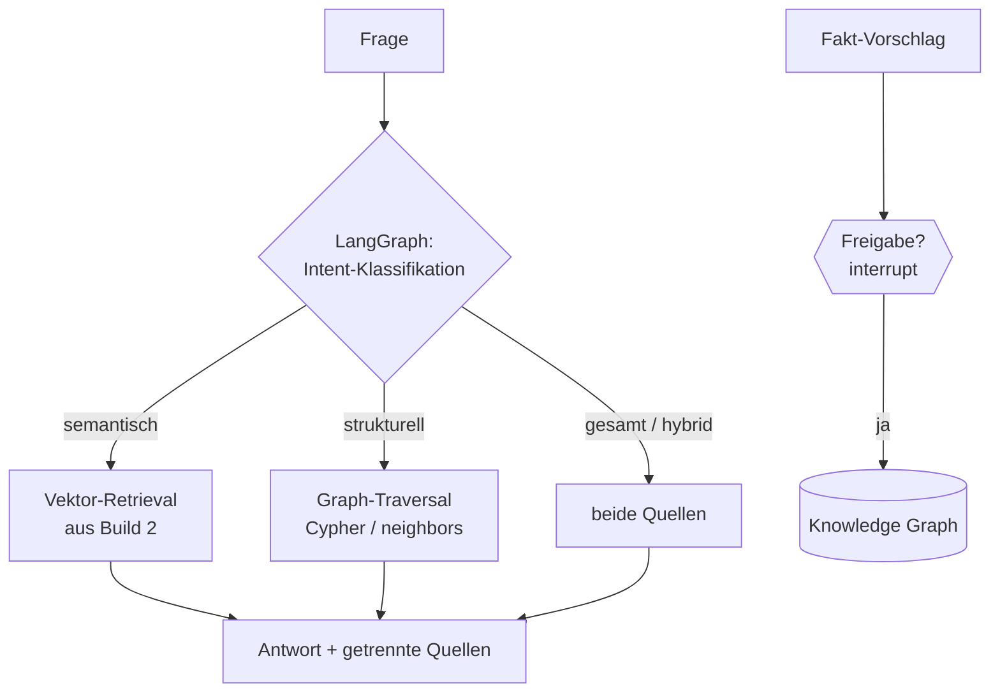

# Same Problem, Three Architectures 🏗️

> **Das Leitprinzip der Akademie:** Du baust denselben **Personal Knowledge Assistant** drei Mal – erst mit reinem Python, dann mit LangChain + Vektor-RAG, schließlich mit LangGraph + Knowledge Graph + Hybrid-Retrieval. Jede Stufe löst die größten Schmerzen der vorherigen – und erzeugt neue, die die nächste Stufe begründen.

**Wo du die drei Builds findest:**

| Build | Modul | Ordner |
|---|---|---|
| Build 1 – Pure Python | Modul 2 | [`02-build1-python-assistent/`](../02-build1-python-assistent/README.md) |
| Build 2 – LangChain + Vektor-RAG | Modul 3 | [`03-build2-langchain-rag/`](../03-build2-langchain-rag/README.md) |
| Build 3 – LangGraph + KG + Hybrid | Modul 5 (Finale: Modul 7) | [`05-build3-langgraph-graphrag/`](../05-build3-langgraph-graphrag/README.md) · [`final-project/knowledge-research-agent/`](../final-project/knowledge-research-agent/README.md) |

---

## Die drei Architekturen auf einen Blick

### Build 1 – Pure Python



**Wie es funktioniert:** Alles ist dein Code: `lade_dokumente()`, `suche_relevant()` (Wort-Überlappung), `baue_prompt()` (String-Bau), direkter `client.chat.complete()`-Call. Der Chatbot-Verlauf aus Modul 1 kommt als Liste dazu.

**Was du implementierst:** jede Funktion selbst – absichtlich!

**Einfacher geworden:** nichts – das ist der Punkt! Du verstehst jeden Schritt.
**Komplizierter:** sobald du mehrere Quellen, Verlauf, Zitate und Fehlerfälle willst, **dupliziert sich Logik überall** – genau das dokumentierst du in Aufgabe 2.2.

**Limitierungen:** Wortsuche findet keine Synonyme („freie Tage" ≠ „Urlaub"); Prompt-Bau ist Copy-Paste-Gefahr; kein System für Chunks/Embeddings/Retrieval; alles schwer testbar, weil alles verflochten ist.

**Warum Build 2 sich lohnt:** Ein Framework soll den **Boilerplate** übernehmen (Prompts, Modelle, Parsing) – und semantische Suche soll das Synonym-Problem lösen.

---

### Build 2 – LangChain + Vektor-RAG

```mermaid
flowchart LR
    D[Dokumente] --> SPL[RecursiveCharacterTextSplitter] --> EMB[Embeddings]
    EMB --> DB[(Chroma<br/>Vektor-DB)]
    F[Frage] --> RET[Retriever<br/>sinngleiche Chunks]
    DB --> RET
    RET --> P[ChatPromptTemplate<br/>mit {context}] --> M[ChatMistralAI] --> PAR[StrOutputParser]
    PAR --> A[Antwort]
    RET --> Q[Quellen aus Metadaten]
```

**Wie es funktioniert:** LangChain-Bausteine ersetzen deine Handarbeit: Template statt String-Bau, Chat-Modell-Objekt statt Client, Parser statt Antwort-Extraktion – verkettet mit `|` zur Chain. Die Wortsuche wird durch **Embeddings + Vektor-DB** ersetzt: Suche nach *Bedeutung* statt nach Wörtern.

**Was du implementierst:** die Chain-Komposition, die RAG-Pipeline (Retriever-Ergebnisse in den Prompt), Quellen aus Metadaten, die „Weiß ich nicht"-Logik, strukturierte Ausgaben (Pydantic).

**Einfacher geworden:** Prompts/Modelle/Parsing sind standardisiert und wiederverwendbar; Synonym-Suche funktioniert („freie Tage" findet „Urlaubsantrag"); Pydantic-Validierung steckt in `with_structured_output`; die Frontend-Anbindung aus Modul 2 läuft unverändert weiter.
**Komplizierter geworden:** neue Abstraktionen (Runnable, `|`, Retriever), neue Fehlerquellen (falsche Chunk-Größe, gemischte Embedding-Modelle), und: Der Kontext muss **getriggert** werden – die Chain selbst orchestriert kein verzweigtes Verhalten.

**Limitierungen:** Vektor-Suche findet **sinngleiche Texte**, aber kennt **keine Beziehungen**: „Wer arbeitet woran?" oder „Wie hängt A mit B zusammen?" bleibt unbeantwortet – selbst wenn alle Fakten im System stecken. Es gibt keine Steuerung für Verzweigungen (Vektor ODER Graph ODER beide), keine Zustandshaltung über Schritte hinweg.

**Warum Build 3 sich lohnt:** Fragen über **Verbindungen** brauchen einen Knowledge Graph; die **Wahl** zwischen zwei Wissensquellen braucht einen Workflow mit Verzweigung – LangGraph.

---

### Build 3 – LangGraph + Knowledge Graph + Hybrid-RAG



**Wie es funktioniert:** Die beiden Wissenssysteme laufen **parallel** als Quellen: die Vektor-DB aus Build 2 (weiterverwendet!) und ein Knowledge Graph (Neo4j oder GraphStore-Fallback). Ein **LangGraph-Workflow** entscheidet pro Frage die Route (Intent-Klassifikation → konditionale Kanten), hält den State (Frage, Route, Dokumente, Graph-Fakten) und erzwingt Freigaben (`interrupt`/`resume`) vor Graph-Schreibzugriffen. Das Finale (Modul 7) packt das Ganze hinter eine FastAPI mit Streamlit-Frontend.

**Was du implementierst:** die Workflow-Knoten und konditionalen Kanten, die Intent-Regeln, den Freigabe-Flow mit Audit-Log – die Retrieval-Bausteine **wiederverwendest** du aus Build 2 und Modul 4.

**Einfacher geworden:** Verzweigungen, Loops, Zustand und Freigaben sind jetzt *erste-Klasse-Konzepte* statt handgeklebter if-Orgien; Beziehungsfragen werden beantwortbar (Emergenz!); beide Quellen sind sauber getrennt wartbar; das Ganze ist über Checkpointer unterbrechbar und über ein Frontend bedienbar.
**Komplizierter geworden:** mehr bewegliche Teile (Graph-Pflege, Entity Resolution, NL→Cypher-Sicherheit, zwei Indizes), und du musst verstehen, **wann** welche Route richtig ist – falsche Klassifikation kostet Qualität oder Geld.

**Limitierungen:** Klassifikation kann falsch liegen; der Graph muss gepflegt werden (schlechte Fakten vergiften alle künftigen Antworten); NL→Cypher braucht die Whitelist-Bremse; für echte Produktion fehlen Auth, Skalierung, Monitoring (Modul 8 zeigt die Richtung).

**Warum es das Wert war:** Dieses System beantwortet **alle** Fragen-Typen deines Assistenten – und du kannst jede Entscheidung begründen.

---

## Die Vergleichstabelle

| Kriterium | 🧱 Build 1: Pure Python | 🔗 Build 2: LangChain + Vektor-RAG | 🚀 Build 3: LangGraph + KG + Hybrid |
|---|---|---|---|
| **Wissensquelle** | Text-Abschnitte im RAM | Vektor-DB (Chroma) + Embeddings | Vektor-DB **und** Knowledge Graph (Neo4j/GraphStore) |
| **Suche** | Wort-Überlappung | semantisch (Bedeutung) | semantisch **und** strukturell (Traversierung, Emergenz) |
| **Prompt-Erzeugung** | eigene String-Bau-Funktion | `ChatPromptTemplate` | Templates + workflow-abhängige Prompts |
| **Orchestrierung** | eine Funktion (`beantworte`) | eine Chain (gerade Linie) | Graph mit Verzweigung, Loop, State, Freigabe |
| **„Wer arbeitet woran?"** | ❌ | ❌ (findet bestenfalls Texte *über* Beziehungen) | ✅ exakte Traversierung |
| **„Wie hängt A mit B zusammen?"** | ❌ | ❌ | ✅ Pfad – selbst wenn nirgends geschrieben |
| **„Was steht über X?" (Synonyme)** | ❌ | ✅ | ✅ (+ Route entscheidet automatisch) |
| **Quellenangabe** | eigene Logik | Metadaten des Retrievers | getrennt: Doku-Fundstellen vs. Graph-Fakten |
| **Mensch im Loop** | ❌ | ❌ | ✅ Freigabe vor Graph-Änderungen + Audit |
| **Testbarkeit** | schwer (alles verflochten) | gut (Runnables, Mocks) | sehr gut (Nodes isoliert, Offline-Modus, CI) |
| **Frontend** | Streamlit direkt (Modul 2) | Streamlit direkt (läuft weiter) | FastAPI + Streamlit: Chat, Graph-Explorer, Freigaben (Modul 7) |
| **Haupt-Limitierung** | Synonyme, Boilerplate-Duplikation | keine Beziehungen, keine Verzweigung | Klassifikationsfehler, Graph-Pflege, Produktions-Reife |

## Wann baust du welche Architektur? (Faustregel)

- **Build 1 reicht**, wenn: ein Skript, eine Quelle, klare Wörter, ein Nutzer (du selbst). Lernen und Prototypen – und: um zu **verstehen**, was Frameworks tun.
- **Build 2 ist richtig**, wenn: Nutzer freie Fragen über **Dokumente** stellen (Synonyme!); die Anwendung eine gerade Pipeline ist; du Geschwindigkeit willst.
- **Build 3 lohnt sich**, wenn: Fragen **Beziehungen** betreffen; mehrere Quellen kombiniert werden müssen; der Ablauf Entscheidungen/Schleifen/Freigaben braucht; Nutzer das System über eine Oberfläche bedienen.

**Die ehrliche Wahrheit:** Die meisten echten Projekte starten bei Build 2 – und wachsen nach Build 3, sobald die erste „Wie hängt das zusammen?"-Frage kommt. Und wer Build 1 überspringt, weiß nie, was unter der Haube passiert.
