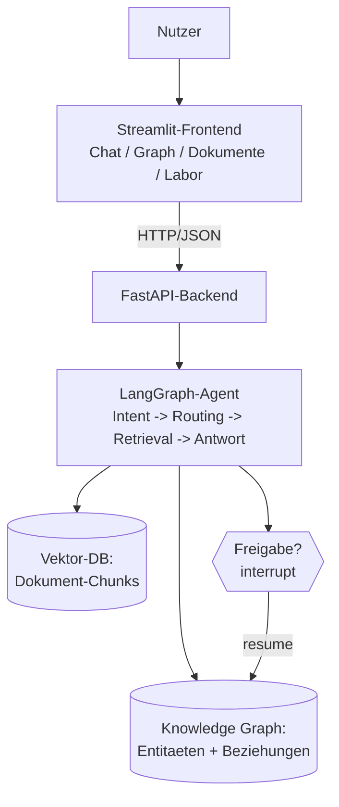

# 🎓 Capstone: Personal Knowledge & Research Agent

**Die Abschluss-Anwendung der Akademie:** Ein vollständiges System mit hybrider Wissensarchitektur (Vektor-DB + Knowledge Graph), LangGraph-Agenten-Workflow, FastAPI-Backend, Streamlit-Frontend und Human-in-the-Loop-Freigaben.



## Features

| Bereich | Was du machen kannst |
|---|---|
| **Chat mit Agent** | Fragen stellen; der Agent klassifiziert die Frage und wählt die Retrieval-Route (Vektor / Graph / Hybrid) |
| **Knowledge-Graph-Explorer** | Graph interaktiv sehen (PyVis), Nodes anklicken, Nachbarn erkunden, Entity-Suche |
| **Dokumente & RAG** | Text-Dokumente hochladen, Dokumentliste sehen, Fragen mit Quellenfundstellen |
| **Agent-Workflow-Ansicht** | Pro Antwort sehen: welche Route, welche Quellen, welche Fakten – getrennt nach Herkunft |
| **Prompt-Labor** | System-/User-Prompts und Temperature experimentell setzen – Wirkungen sofort sichtbar |
| **Freigaben (Human-in-the-Loop)** | Fakten-Vorschläge prüfen und genehmigen/ablehnen – destruktive Graph-Änderungen nur mit dir |
| **Verlauf** | Alle Fragen/Antworten mit Routen und Quellen nachlesen |

## Schnellstart (lokal, offline – ohne API-Key!)

```bash
# 1. Abhängigkeiten (Projektwurzel der Akademie):
pip install -r requirements.txt

# 2. Backend starten (vom Akademie-Hauptordner):
uvicorn "final-project.knowledge-research-agent.backend.api.main:app" --port 8000
#    (Alternative: cd final-project/knowledge-research-agent/backend &&
#      uvicorn api.main:app --port 8000)

# 3. Frontend starten (zweites Terminal):
streamlit run "final-project/knowledge-research-agent/frontend/app.py"
#    Browser öffnet sich automatisch (http://localhost:8501)
```

> **Offline-Modus:** Ohne `MISTRAL_API_KEY` läuft alles kostenfrei: Retrieval, Graph, Workflow, Freigaben sind echt; nur die Sprachformulierung des LLM ist simuliert (`[OFFLINE]`). Mit Key in `.env` (siehe `.env.example`) wird Mistral für Klassifikation und Antwortformulierung genutzt.

## Mit Docker Compose (inkl. Neo4j)

```bash
cd final-project/knowledge-research-agent
docker compose up --build
# Frontend: http://localhost:8501 | Backend-Doku: http://localhost:8000/docs
# Neo4j-Browser: http://localhost:7474 (neo4j / lernakademie)
```

Der Backend-Service nutzt ohne laufendes Neo4j automatisch den GraphStore-Fallback – die Anwendung startet also **immer**.

## Architektur (auch Aufgabe 15.3 zum Nachvollziehen)

```
final-project/knowledge-research-agent/
├── backend/
│   ├── api/         # FastAPI-Endpunkte (main.py)
│   ├── agents/      # Agent-Workflow-Logik (research_agent.py)
│   ├── graphs/      # LangGraph-Workflow (workflow.py: Intent -> Routing)
│   ├── retrieval/   # Vektor- + Graph-Retrieval (vector.py, graph_store_api.py)
│   ├── models/      # Pydantic-Schemas für Requests/Responses
│   ├── services/    # Sitzungen, Verlauf, Konfiguration
│   └── seed/        # Start-Dokumente (im Repo, offline nutzbar)
├── frontend/
│   ├── app.py       # Streamlit-Hauptoberfläche (Navigation)
│   ├── pages/       # Graph-Explorer, Prompt-Labor (python-file pages)
│   └── components/  # PyVis-Graph-Visualisierung
├── database/
│   ├── schema/      # Graph-Schema-Doku (Labels, Beziehungstypen)
│   └── seed/        # Seed-Graph-Daten
├── tests/           # API-Tests (laufen offline in CI)
├── docker-compose.yml
├── Dockerfile       (im backend/, siehe Compose)
└── .env.example
```

## Beispiel-Fragen zum Ausprobieren

- „Was wissen wir über das AI-Assistant-Projekt?" → **Hybrid** (Doku + Graph)
- „Wer hängt mit Anna zusammen?" → **Graph-Route** (Traversierung)
- „Was steht im Firmenprofil über Weiterbildung?" → **Vektor-Route**
- „Wie hängt Ben mit dem Projekt zusammen?" → **Graph-Route** (Emergenz!)

Jede Antwort zeigt ihre **Quellen** (Dokument-Fundstellen vs. Graph-Fakten) – du siehst immer, woher das Wissen kommt.

## Sicherheitshinweise

- API-Keys nur in `.env` (nie committen – siehe Akademie-Stufe 9).
- Graph-Schreibzugriffe **nur** über den Freigabe-Workflow (interrupt + resume).
- LLM-generierte Abfragen werden vor Ausführung durch die lesende Whititelist geprüft.
- Diese Anwendung ist ein **Lernsystem für den lokalen Betrieb** – vor einer Veröffentlichung im Internet: Stufe 15.3/9 (Auth, HTTPS, Rate-Limits) umsetzen.
